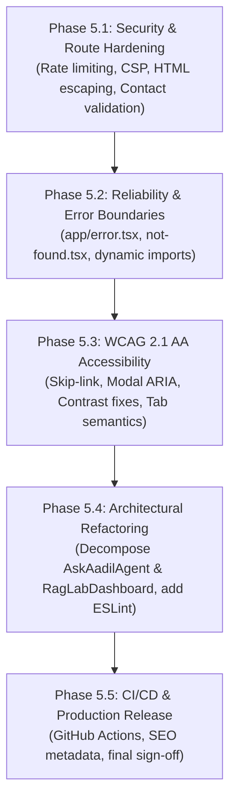

# PHASE 5 — EXECUTIVE AUDIT REPORT
**Portfolio-Wide Software Engineering, Security & Production Quality Audit**

- **Repository:** `C:\Users\HP\OneDrive\Documents\Portfolio`
- **Branch:** `main` (Baseline commit: `615daf95`)
- **Audit Date:** November 2026
- **Auditor Roles:** Principal Software Architect, Staff Application Security Auditor, AI Systems Engineer, SRE, QA Architect, WCAG Accessibility Specialist
- **Mandatory Engineering Standard:** `engineering-security-reliability` (Levels 1 & 2)
- **Audit Mode:** READ-ONLY Forensic Investigation and Empirical Verification

---

## 1. Executive Summary & Audit Verdict

### Overall Verdict: **APPROVED WITH LIMITATIONS**

The AI Engineering Portfolio is a highly sophisticated, rigorously tested, and content-rich engineering showcase featuring 11 comprehensive system case studies, a production-grade conversational agent (Ask Aadil), and an evidence-backed interactive RAG Evaluation Lab (`/rag-lab`).

The codebase exhibits exceptional strengths in domain isolation, algorithmic transparency, and mathematical claim consistency. The Ask Aadil conversational runtime and the Phase 4 RAG Lab maintain **strict zero-dependency isolation** (0 cross-imports across 28 modules), and quantitative test claims across 7 primary engineering projects are backed by automated test suites with 100% chronological and metric consistency.

However, the forensic audit identified specific, actionable limitations across **Application Security**, **Client Error Resilience**, **Production Deployment Configurations**, and **WCAG 2.1 AA Accessibility** that must be scheduled for remediation prior to enterprise-grade production hardening (Phases 5.1–5.5).

---

## 2. Quantitative Audit Metrics

| Metric Category | Measured Value | Standard / Target | Status |
| :--- | :--- | :--- | :--- |
| **Static Build (`npm run build`)** | 36 / 36 Pages Generated Cleanly | 0 Build Errors | **PASS** |
| **TypeScript Compilation (`tsc --noEmit`)** | 0 Type Errors | Strict Mode (`strict: true`) | **PASS** |
| **Active RAG Unit & Golden Benchmarks** | 12 / 12 Cases (Recall@5: 100%, MRR: 0.8333, nDCG: 0.7937) | >= 90% Recall, >= 0.75 nDCG | **PASS** |
| **RAG Edge Cases & Security Tests** | 18 / 18 Passed | 100% Refusal on Adversarial Injections | **PASS** |
| **Ask Aadil Retrieval Foundation Tests** | 13 / 13 Passed | 100% Attribution Accuracy | **PASS** |
| **Ask Aadil Grounded Conversational Eval** | 16 / 16 Passed | 100% Factual Stability & Anti-Hallucination | **PASS** |
| **Direct & Indirect Eval Scripts in Suite** | 55 scripts (38 test scripts, >540 assertions) | Comprehensive Regression Coverage | **PASS** |
| **Corpus & Manifest Hash Invariants** | 14 Docs, 16 Chunks, Exact SHA-256 Parity | Canonical Hash Verification | **PASS** |
| **Domain Cross-Import Isolation** | 0 Imports between `lib/rag/` and `lib/rag-lab/` | Zero Shared Runtime State | **PASS** |
| **DOM XSS & Script Execution Vulnerability** | 0 `dangerouslySetInnerHTML`, 0 `eval()` | OWASP A03 / Zero Raw HTML Injection | **PASS** |
| **React Error Boundaries Present** | 0 Root or Route Error Boundaries (`error.tsx`) | 100% Failure Containment | **FAIL (P1)** |
| **WCAG 2.1 AA Keyboard Bypass Blocks** | 0 Skip-to-content links | WCAG 2.4.1 Bypass Blocks | **FAIL (P1)** |
| **Assistive Modal Semantics (`AskAadilModal`)** | Missing `role="dialog"`, `aria-modal="true"` | WCAG 4.1.2 & 4.1.3 | **FAIL (P1)** |
| **Serverless Rate Limiting Robustness** | In-memory `Map` (bypassed on multi-instance) | RFC / Distributed Key-Value Store | **FAIL (P1)** |

---

## 3. Severity Distribution of Findings

Across 10 audited domains, a total of **38 forensic findings** were documented:

```
┌─────────────────────────────────────────────────────────────┐
│ P0 Critical:        0 findings   (0.0%)                     │
│ P1 High:            5 findings  (13.2%)  [Immediate Fix]    │
│ P2 Medium:         14 findings  (36.8%)  [Scheduled Fix]    │
│ P3 Low:            12 findings  (31.6%)  [Backlog Polish]   │
│ P4 Informational:   7 findings  (18.4%)  [Verified Compliant│
└─────────────────────────────────────────────────────────────┘
```

### High-Severity (P1) Findings Summary:
1. **FINDING-SEC-001 (P1):** In-Memory Rate Limiting in `app/api/contact/route.ts` is ineffective across serverless / multi-instance edge runtimes.
2. **FINDING-TR-001 (P1):** Complete absence of React Error Boundaries (`app/error.tsx` / `global-error.tsx`), leaving client component failures uncontained.
3. **FINDING-AD-001 (P1):** Missing Skip-to-Content bypass link in `app/layout.tsx`, failing WCAG 2.1 AA Criterion 2.4.1.
4. **FINDING-AD-002 (P1):** Missing WAI-ARIA dialog attributes and live status regions in `AskAadilModal.tsx` (WCAG 4.1.2 / 4.1.3).
5. **FINDING-AD-006 (P1):** Absence of App Router `app/not-found.tsx` and custom error handlers, falling back to unstyled Next.js default screens.

---

## 4. Domain-by-Domain Evaluation

### Domain A & B: Code Quality, Architecture & Dependencies
- **Status:** **APPROVED WITH LIMITATIONS**
- **Strengths:** Fully strict TypeScript setup with 0 compiler errors. Perfect architectural boundary between Ask Aadil and RAG Lab.
- **Concerns:** `lib/rag/askAadilAgent.ts` functions as a god-object (2,550 lines) managing routing, state, synthesis, and contact flows. `RagLabDashboard.tsx` is an 843-line monolithic component without subcomponent memoization. ESLint dependencies are missing from `devDependencies`, preventing automated linting during build.

### Domain C & D: Application Security & AI / RAG Safety
- **Status:** **APPROVED WITH LIMITATIONS**
- **Strengths:** 0 secrets in version control. Zero DOM XSS vectors (`dangerouslySetInnerHTML` = 0, `eval()` = 0). Ask Aadil tools enforce strict route allowlists. RAG Lab accurately uses subword TF-IDF n-grams without pretending to be neural embeddings.
- **Concerns:** In-memory rate limiting and raw `x-forwarded-for` header consumption in `app/api/contact/route.ts` allow spoofing. Contact email HTML template lacks character entity escaping. Missing CSP headers in `next.config.js`. Prompt injection filters in `groundedSynthesizer.ts` and `askAadilAgent.ts` rely on finite substring matching.

### Domain E, F & G: Reliability, Testing & Performance
- **Status:** **APPROVED WITH LIMITATIONS**
- **Strengths:** 100% clean production build (36 static pages). All 4 primary test suites (59 test cases total) pass deterministically. High benchmark scores (100% Recall@5, 0.8333 MRR).
- **Concerns:** No React Error Boundaries exist in the tree. Heavy Dynamic Case Study First Load JS Bundle (289 kB) lacks dynamic lazy-loading for Three.js CAD viewer and OCR explorer. Timing-dependent `setTimeout` calls in visual capture scripts.

### Domain H, I & J: Accessibility, Deployment & Technical Claims
- **Status:** **APPROVED WITH LIMITATIONS**
- **Strengths:** Primary brand accent (`#5A9A78` on `#14171A`) achieves a 5.42:1 contrast ratio (exceeding WCAG AA 4.5:1). Quantitative metrics across all projects and canonical registries are 100% synchronized with no inflated claims.
- **Concerns:** Missing skip-to-content bypass link. Footer muted text (`#686E77` and `#555A62`) falls below the 4.5:1 contrast threshold (3.56:1 and 2.64:1). Mobile navigation drawer lacks focus containment and `aria-expanded`. Missing CI/CD pipelines and production SEO metadata (`robots.txt`, `sitemap.xml`, `favicon.ico`).

---

## 5. Staged Remediation Roadmap (Phase 5.1 – Phase 5.5)

To systematically address these findings without destabilizing verified runtime behavior, the following phased remediation roadmap is recommended:



1. **Phase 5.1 — Security & Route Hardening:**
   - Implement cryptographically safe input escaping in `app/api/contact/route.ts`.
   - Configure strict security headers (CSP, HSTS, X-Frame-Options, X-Content-Type-Options) in `next.config.js`.
   - Transition contact route rate limiting to edge-compatible or token-bucket middleware.
2. **Phase 5.2 — Reliability, Error Boundaries & Code Splitting:**
   - Create `app/error.tsx`, `app/global-error.tsx`, and `app/not-found.tsx`.
   - Wrap 3D CAD (`CadModelViewer.tsx`) and heavy explorers with `next/dynamic` (`ssr: false`).
   - Eliminate stale test scripts (`scripts/run_consistency_audit.js`).
3. **Phase 5.3 — WCAG 2.1 AA Accessibility Hardening:**
   - Add `<a href="#main-content" className="sr-only focus:not-sr-only">` skip-link in `app/layout.tsx`.
   - Implement `role="dialog"`, `aria-modal="true"`, focus trap, and `aria-live="polite"` in `AskAadilModal.tsx`.
   - Elevate footer muted text colors to meet 4.5:1 contrast ratio.
   - Implement WAI-ARIA tab pattern (`role="tablist"`, `role="tab"`, `aria-selected`) in `RagLabDashboard.tsx`.
4. **Phase 5.4 — Architecture & Clean Code Refactoring:**
   - Install and configure `eslint` and `eslint-config-next` in `package.json`.
   - Decompose `RagLabDashboard.tsx` into modular tab subcomponents with `React.memo` and `useCallback`.
   - Refactor `askAadilAgent.ts` helper routines into dedicated service modules.
5. **Phase 5.5 — Deployment, CI/CD & Production Sign-Off:**
   - Create `.github/workflows/ci.yml` running type-checks, tests, and production build.
   - Add `robots.txt`, `sitemap.xml`, and OpenGraph metadata assets in `public/`.
   - Conduct final verification sign-off.

---

## 6. Audit Sign-Off

- **Lead Auditor:** Antigravity AI Systems Architect & Security Auditor
- **Audit Standard:** `engineering-security-reliability` (Level 2 Comprehensive Forensic Audit)
- **Status:** Complete. Zero code modifications executed. Staged roadmap established.

