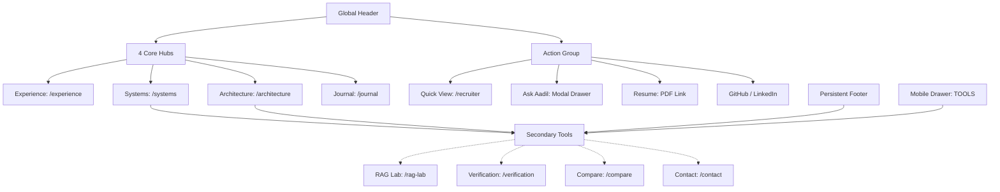

# PHASE 7.4 — CONTENT AND NAVIGATION REPORT
## Navigation Architecture, IA Restructuring & Recruiter Pathway Analysis

**Date:** November 13, 2026  
**Engineering Standard:** `/engineering-security-reliability` — Level 1  
**Repository:** `C:\Users\HP\OneDrive\Documents\Portfolio`  
**Verdict:** **PASS WITH QUALIFICATIONS**  

---

## 1. Information Architecture & Navigation Mapping

### Before Phase 7.4 (Cognitive Overload in Header)
Prior to Phase 7.4, the primary desktop navigation bar presented 8 top-level links plus 5 secondary action pills and social icons:
- `Timeline` (`/experience`)
- `Journal` (`/journal`)
- `Systems` (`/systems`)
- `Architecture` (`/architecture`)
- `Compare` (`/compare`)
- `RAG Lab` (`/rag-lab`)
- `Verification` (`/verification`)
- `Contact` (`/contact`)
- Action pills: `Ask Aadil`, `Quick View`, `Resume`, `GitHub`, `LinkedIn`

**Issues:**
1. Horizontal density resulted in wrapping issues at compact desktop viewports (1024px–1279px).
2. Deep specialized engineering tools (`Verification`, `Compare`, `RAG Lab`) competed directly with foundational recruiter hubs (`Experience`, `Systems`).
3. The mobile drawer was an unorganized flat list of 9 links without visual priority or categorized hierarchy.

---

### After Phase 7.4 (Disciplined 4-Hub Structure)

---

## 2. Desktop Navigation Hub Breakdown

| Hub Name | Route | Purpose | Subordinate Contextual Links |
| :--- | :--- | :--- | :--- |
| **Experience** | `/experience` | Chronological career progression, Wayground tenure, independent research | Wayground, Solace, Atlas, EDA, Ask Aadil |
| **Systems** | `/systems` | Master catalog of 11 AI and full-stack systems | Direct case studies, Compare presets, RAG Lab |
| **Architecture** | `/architecture` | Interactive execution flows, state graphs, failure boundaries | Component graphs, Verification cross-links, Systems |
| **Journal** | `/journal` | 18 Architecture Decision Records and engineering retrospectives | Defect logs, failure postmortems, verified tests |

### Primary Action Pills
- **Quick View** (`/recruiter`): 30-second curated executive summary for time-constrained recruiters.
- **Ask Aadil** (Custom Event): Grounded conversational agent with discrete source boundary querying.
- **Resume** (External PDF): Verified curriculum vitae.
- **GitHub & LinkedIn**: Direct developer profile links.

---

## 3. Secondary Destinations Discoverability Matrix

The Phase 7.4 specification strictly prohibited deleting or making secondary destinations inaccessible. The matrix below confirms all secondary routes have multiple discoverable inbound paths:

| Secondary Destination | Header Mobile Drawer | Persistent Footer | Inbound Contextual Links | Direct URL Resolution |
| :--- | :---: | :---: | :--- | :---: |
| `/rag-lab` | Yes (`TOOLS`) | Yes | Systems Archive, AI Engineering, Case Studies | HTTP 200 (Static) |
| `/verification` | Yes (`TOOLS`) | Yes | Systems Archive, Architecture Explorer, Case Studies | HTTP 200 (Static) |
| `/compare` | Yes (`TOOLS`) | Yes | Systems Archive, Architecture Explorer | HTTP 200 (Static) |
| `/contact` | Yes (`CONNECT`) | Yes | Homepage Section 06, Header Action Group | HTTP 200 (Static) |

---

## 4. Mobile Drawer Architecture & Usability

The mobile drawer was restructured from a flat list into 3 distinct thematic groups:

1. **EXPLORE (2x2 Grid):**
   - `Experience` (Compass icon)
   - `Systems` (Cpu icon)
   - `Architecture` (Layers icon)
   - `Journal` (BookOpen icon)
2. **TOOLS & BENCHMARKS (Vertical Stack with Metadata Badges):**
   - `RAG Lab` → *"Interactive Retrieval Evaluation"*
   - `Verification` → *"Portfolio Evidence Register"*
   - `Compare` → *"Architectural Trade-Off Matrix"*
3. **CONNECT & ACTIONS (Action Grid + Direct Links):**
   - Prominent `Ask Aadil` button and `Contact` link
   - Social links (`GitHub`, `LinkedIn`) and direct `Resume (PDF)` download

### Mobile Usability & Ergonomics
- **Touch Target Sizes:** Minimum 44x44px hit-box across all mobile drawer items.
- **Scroll Containment:** Body scroll lock (`document.body.style.overflow = 'hidden'`) prevents background scrolling during menu interaction.
- **Drawer Height:** Capped at `max-h-[calc(100vh-60px)]` with smooth internal kinetic scrolling.

---

## 5. Recruiter Conversion Pathway Audit

### The Friction-Reduced Recruiter Journey
1. **Entry Point 1 — Hero Direct Bridge:**
   - Link text: *"Short on time? View the 30-second executive summary →"*
   - Position: Directly beneath the two primary buttons (`Explore Projects →` and `View Resume (PDF)`).
   - Benefit: Immediately visible above the fold on mobile and desktop without requiring PDF download or full page exploration.
2. **Entry Point 2 — Global Header Action Pill:**
   - Visual: Distinct emerald-tinted badge with lightning icon (`Zap`).
   - Position: Fixed sticky header across all routes.
3. **Entry Point 3 — Mobile Drawer Sticky Header:**
   - High-contrast green callout button pinned to the top of the mobile navigation panel.
4. **Destination Experience (`/recruiter`):**
   - Curated high-impact summary of core skills, career chronology, flagship projects, and direct contact options.

---

## 6. Truthful Content & Technical Tool Callouts

Each technical tool now presents an accessible `ExecutiveSummary` card before visitors encounter technical depth:

### 1. RAG Lab (`/rag-lab`)
- **Badge:** `RETRIEVAL & EVALUATION // RAG LAB`
- **Heading:** `Why this matters`
- **Summary:** *"Explore how lexical and vector-space retrieval, hybrid ranking, context budgets and evidence validation influence grounded AI responses."*
- **Supporting Description:** *"Experiment with retrieval strategies, inspect ranked evidence, compare retrieval quality, and observe when the system should abstain because the available evidence is insufficient."*
- **Truthful Boundaries Verified:**
  - TF-IDF character n-gram cosine retrieval is accurately described as vector-space retrieval without claiming dense neural embedding models.
  - Abstention is described as deterministic rejection of unverified claims, explicitly avoiding false guarantees of "zero hallucinations".

### 2. Architecture Explorer (`/architecture`)
- **Badge:** `SYSTEM TOPOLOGY // ARCHITECTURE EXPLORER`
- **Heading:** `Why this matters`
- **Summary:** *"Explore the architecture of 11 AI and software systems, including component relationships, state transitions, data flows and failure boundaries."*
- **Supporting Description:** *"Move beyond project descriptions to inspect how systems are structured, how their components interact, and where deterministic controls and failure containment are applied."*
- **Truthful Boundaries Verified:**
  - Preserves exact 11-system scope and Level 1 vs Level 2 exploration depths.

### 3. Verification Dashboard (`/verification`)
- **Badge:** `EVIDENCE & RIGOR // VERIFICATION`
- **Heading:** `Why this matters`
- **Summary:** *"Inspect the portfolio's evidence registry, quantitative claims, reproduction instructions and verification results."*
- **Supporting Description:** *"Trace engineering claims to supporting evidence, review known limitations, compare reported metrics, and verify exactly 33 master evidence records, 15 system verification summaries, 771 dedicated verification checks, and 758 assertions in earlier regression baseline across dedicated dashboard checks, regression baselines, and upstream project suites."*
- **Truthful Boundaries Verified:**
  - Explicitly distinguishes 33 evidence records, 15 summaries, 771 dedicated dashboard checks, and 758 baseline assertions from upstream test totals.

---

## 7. Artifact Links
- Screenshots: [audit_results/phase_7_4/mobile_drawer_open_390px.png](file:///C:/Users/HP/OneDrive/Documents/Portfolio/audit_results/phase_7_4/mobile_drawer_open_390px.png)
- Recruiter Quick View Screenshot: [audit_results/phase_7_4/recruiter_quick_view.png](file:///C:/Users/HP/OneDrive/Documents/Portfolio/audit_results/phase_7_4/recruiter_quick_view.png)
- Header Component: [components/Header.tsx](file:///C:/Users/HP/OneDrive/Documents/Portfolio/components/Header.tsx)
- Footer Component: [components/Footer.tsx](file:///C:/Users/HP/OneDrive/Documents/Portfolio/components/Footer.tsx)

