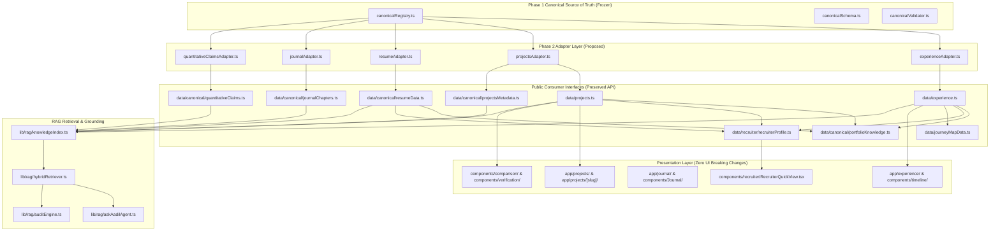
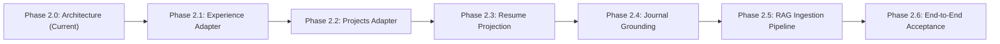

# Portfolio — Phase 2.0: Consumer Migration Architecture & Readiness Assessment
## Transitioning Downstream Consumers to the Authoritative Canonical Foundation

**Role:** Principal Software Architect, TypeScript Migration Engineer, Data Governance Architect, and Adversarial Test Strategist  
**Repository:** `C:\Users\HP\OneDrive\Documents\Portfolio\`  
**Branch:** `main`  
**Reported Implementation Baseline:** `445a88055a44b9d9bffb301cf144b32a2648adee`  
**Phase:** 2.0 — Architecture and Readiness Assessment  
**Authorization Context:** Phase 1 Accepted & Frozen; Phase 2 Authorized by `PHASE_1_4_FINAL_INDEPENDENT_ACCEPTANCE_AUDIT.md`  
**Execution Mode:** STRICT READ-ONLY — ARCHITECTURE ASSESSMENT & MIGRATION BLUEPRINT  
**Deliverable:** `research/audits/reconciliation/PHASE_2_0_CONSUMER_MIGRATION_ARCHITECTURE.md`

---

# 1. Executive Summary

Phase 1 successfully established an authoritative, evidence-backed, immutable canonical foundation:
- Schema: `data/canonical/canonicalSchema.ts`
- Registry: `data/canonical/canonicalRegistry.ts` (7 career records, 12 project records, 13 technical claims, 17 evidence records)
- Validator: `data/canonical/canonicalValidator.ts` (calendar validation, metric governance, dual-index IP protection, referential integrity)
- Test Suite: `scripts/test_canonical_registry.ts` (96/96 passing assertions)

Currently, the portfolio’s presentation layer, recruiter views, and RAG retrieval pipelines rely on fragmented, legacy data stores:
- `data/experience.ts`: Contains conflicting dates (e.g. Digiplus Jun–Jul 2022 vs. approved Jun–Sep 2022; Independent study Aug 2022 vs. approved Sep 2022) and flattened timeline items.
- `data/projects.ts`: Exposes proprietary code as public GitHub URLs (e.g. `vm-copy` public repo vs. verified `publicUrl: null`), unverified promotion causality, and heuristic ownership categories.
- `data/canonical/projectsMetadata.ts`: Re-duplicates legacy pre-reconciliation claims, dates, and unverified Catalan catalysts.
- `data/canonical/quantitativeClaims.ts`: Duplicates claims in legacy schemas without typed `metricSubject` or `measurementScope` invariants.
- `data/canonical/resumeData.ts`: Acts as an uncoupled static representation rather than a derived canonical projection.
- `lib/rag/knowledgeIndex.ts`: Ingests across multiple uncoordinated legacy stores with hardcoded ownership classifications.

**Phase 2.0 Objective:** Design an adapter-driven, non-breaking migration architecture that systematically transitions downstream consumers to read from the canonical foundation as their single source of truth, eliminating duplicate data, rectifying factual contradictions, and preserving existing public interfaces.

### Final Readiness Recommendation
# `READY FOR PHASE 2.1 IMPLEMENTATION`

---

# 2. Repository and Branch Baseline

### 2.1. Git State Inspection
- **Repository Root:** `C:\Users\HP\OneDrive\Documents\Portfolio`
- **Active Branch:** `main`
- **Commit Baseline (HEAD):** `445a88055a44b9d9bffb301cf144b32a2648adee`
- **Working Tree Verification (`git status --short`):**
  ```
   M data/canonical/sourceConflicts.ts
  ?? data/canonical/canonicalRegistry.ts
  ?? data/canonical/canonicalSchema.ts
  ?? data/canonical/canonicalValidator.ts
  ?? research/audits/reconciliation/
  ?? scripts/test_canonical_registry.ts
  ```
  *(Zero modifications to downstream consumers; Phase 1 foundation is intact).*

### 2.2. Runtime Environment
- **Node.js:** `v24.19.0`
- **TypeScript:** `5.4.2`
- **Next.js:** `13.4.10` / React `18.2.0`
- **Build & Verification Command:** `npx tsc --noEmit`

---

# 3. Canonical Foundation Inventory

The accepted canonical foundation defines the following authoritative entities:

| Entity Type | File Path | Record Count | Authoritative Invariants |
|---|---|:---:|---|
| **Career Records** | `data/canonical/canonicalRegistry.ts` | 7 | Exact Gregorian intervals, `INTERVAL_OVERLAP` for Oct 2021, `TRANSITION_WINDOW` for Sep 2022, DIGIPPLUS Jun–Sep 2022. |
| **Project Records** | `data/canonical/canonicalRegistry.ts` | 12 | `SOLE_IMPLEMENTER` vs. `COLLABORATIVE_CONTRIBUTOR`, `PRIMARY_ARCHITECT` vs. `DIRECTED_ARCHITECTURE`, `EMPLOYER_PROPRIETARY` (with `publicUrl: null`) vs. `PUBLIC_OPEN_SOURCE`. |
| **Technical Claims** | `data/canonical/canonicalRegistry.ts` | 13 | Mandatory `metricSubject`, mandatory `measurementScope`, `PARTIALLY_VERIFIED` with mandatory caveats, prohibited wording linters. |
| **Evidence Records** | `data/canonical/canonicalRegistry.ts` | 17 | `SOURCE_INVENTORY`, `TEST_DEFINITION`, `MATHEMATICAL_CALCULUS_PROOF`, explicit limitations, verified audit dates. |
| **Validation Engine** | `data/canonical/canonicalValidator.ts` | 1 | Full semantic, referential, and dual-index identity protection (`WAYGROUND_ENTERPRISE_PROJECT_IDS` & `WAYGROUND_ENTERPRISE_SLUGS`). |

---

# 4. Consumer Inventory & Dependency Map

A deep static analysis of all repository imports reveals the exact consumer dependency graph:



### Detailed Consumer Breakdown

#### A. Career Experience (`data/experience.ts`)
- **Existing Exports:** `experience: TimelineItem[]`, `timelineData = experience`.
- **Direct Consumers:**
  - `data/canonical/portfolioKnowledge.ts` (`import { timelineData }`)
  - `lib/rag/auditEngine.ts` (`import { timelineData }`)
  - `lib/rag/hybridRetriever.ts` (`import { timelineData }`)
  - `lib/rag/knowledgeIndex.ts` (`import { timelineData }`)
  - `data/rag/corpus_v1.ts` (referenced as source provenance)
- **Factual Contradictions in Current File:**
  - Digiplus: claims `Jun 2022 — Jul 2022` (Canonical: `2022-06` to `2022-09`).
  - Independent Study: claims `Aug 2022 — Dec 2023` (Canonical: `2022-09` to `2023-12` via `TRANSITION_WINDOW`).
- **Migration Role:** Replace hardcoded array with a read-through projection generated by `experienceAdapter.ts` reading from `canonicalRegistry.careerRecords`.

#### B. Project Registry (`data/projects.ts` & `data/canonical/projectsMetadata.ts`)
- **Existing Exports:**
  - `data/projects.ts`: `projects: Project[]`
  - `data/canonical/projectsMetadata.ts`: `projectsMetadata: ProjectMetadata[]`
- **Direct Consumers of `data/projects.ts`:**
  - `app/projects/page.tsx`
  - `app/projects/[slug]/page.tsx`
  - `app/systems/page.tsx` (re-exports projects page)
  - `app/systems/[slug]/page.tsx` (re-exports project slug page)
  - `data/canonical/portfolioKnowledge.ts` (`import { projects as systemsCatalog }`)
  - `lib/rag/knowledgeIndex.ts` (`import { projects as systemsCatalog }`)
  - `scripts/test_decision_records.ts`, `scripts/test_engineering_cube.ts`
- **Direct Consumers of `data/canonical/projectsMetadata.ts`:**
  - `lib/rag/knowledgeIndex.ts`, `lib/rag/hybridRetriever.ts`, `lib/rag/askAadilAgent.ts`, `lib/rag/intentRouter.ts`, `lib/rag/projectResolver.ts`, `lib/rag/queryUnderstanding.ts`, `lib/rag/tools/portfolioTools.ts`, `lib/rag/tools/navigationTools.ts`, `lib/rag/tools/toolPlanValidator.ts`
  - `data/recruiter/recruiterProfile.ts`
- **Factual Contradictions in Current Files:**
  - `vm-copy` public GitHub repo listed (`https://github.com/aadil-lang/vm-copy-question-generator`) despite being employer proprietary (`publicUrl: null`).
  - `vm-copy` dates listed as `2024-04 to 2024-09` (Canonical: `2025-10` to `2025-11`).
  - Content Builder authorship not clearly separated from candidate.
- **Migration Role:** Replace both with read-through projections generated by `projectsAdapter.ts` reading from `canonicalRegistry.projectRecords`.

#### C. Resume Data (`data/canonical/resumeData.ts`)
- **Existing Exports:** `resumeData: StructuredResume`.
- **Direct Consumers:**
  - `data/canonical/portfolioKnowledge.ts`
  - `data/recruiter/recruiterProfile.ts`
  - `lib/rag/auditEngine.ts`, `lib/rag/hybridRetriever.ts`, `lib/rag/knowledgeIndex.ts`
  - `scripts/test_recruiter_quick_view.ts`
- **Analysis:** `resumeData.ts` contains static resume content (contact info, skills, education) alongside duplicated career and project descriptions.
- **Migration Role:** Convert `resumeData.ts` into a hybrid projection: preserve contact/education/skills formatting while dynamically populating `experience` and `projects` arrays from `canonicalRegistry`.

#### D. Journal Chapters (`data/canonical/journalChapters.ts`)
- **Existing Exports:** `journalChapters: JournalChapterRecord[]`.
- **Direct Consumers:**
  - `lib/rag/hybridRetriever.ts`
  - `lib/rag/knowledgeIndex.ts`
  - `scripts/test_journal_remediation.ts`
- **Analysis:** Contains 14 rich reflective chapters. The narrative reflection is unique, but header metadata (`period`, `organization`, `role`, `connectedSystemSlug`) duplicates career/project records.
- **Migration Role:** Apply a grounding validator (`journalAdapter.ts`) that asserts referential integrity between `connectedSystemSlug` and canonical project slugs, ensuring reflective narrative never contradicts canonical dates or ownership.

#### E. RAG Ingestion Pipeline (`lib/rag/`)
- **Key Modules:** `knowledgeIndex.ts`, `hybridRetriever.ts`, `auditEngine.ts`, `askAadilAgent.ts`.
- **Analysis:** `buildKnowledgeIndex()` currently iterates over raw legacy stores and applies heuristic classification logic:
  ```typescript
  if (system.ownershipCategory === 'wayground-team') {
    ownershipClass = system.slug === 'math-item-bank' ? 'AADIL_CONTRIBUTION' : 'TEAM_OWNERSHIP'
  }
  ```
- **Migration Role:** Ingest directly from canonical records or canonical adapters, attaching machine-readable verification statuses, mandatory caveats, and prohibited interpretations directly to chunk metadata.

---

# 5. Existing Public Interface Inventory

To guarantee zero breaking changes across the application, the public contracts of all migrated modules must remain 100% type- and shape-compatible.

### 5.1. `data/experience.ts` Interface
```typescript
export interface TimelineItem {
  id: string
  period: string
  title: string
  organization?: string
  role?: string
  category?: string
  layerAnnotation: string
  summary: string
  details?: string[]
  technologies?: string[]
  journalChapterRef?: number
  systemSlugRef?: string
  isQuieter?: boolean
  isMilestone?: boolean
  isEnd?: boolean
  milestoneNumber?: number
  isWaygroundSubMilestone?: boolean
  causalChain?: string
  capability?: string
  transition?: string
}

export const experience: TimelineItem[]
export const timelineData: TimelineItem[]
```

### 5.2. `data/projects.ts` Interface
```typescript
export interface Project {
  id: string
  slug: string
  title: string
  tagline: string
  summary: string
  ownershipLabel: string
  ownershipCategory: 'wayground-independent' | 'wayground-team' | 'independent' | 'hackathon' | string
  type: string
  github: string | null
  demo: string | null
  technologies: string[]
  problem: string
  solution: string
  keyFeatures: string[]
  architecturePattern: string
  systemLayers: Array<{ layer: string; components: string; details: string }>
  codeEvidence?: CodeEvidence[]
  benchmarks?: Record<string, string | number>
  // ... presentation attributes
}

export const projects: Project[]
```

### 5.3. `data/canonical/projectsMetadata.ts` Interface
```typescript
export interface ProjectMetadata {
  slug: string
  title: string
  summary: string
  problem: string
  dates: { start: string; end: string }
  ownership: 'independent' | 'team' | 'contribution' | 'professional' | 'hackathon'
  role: string
  technologies: string[]
  portfolioRefs: { timeline: string[]; journal: string[]; system: string }
  externalRefs: { github?: string; demo?: string }
  evidence: string[]
  lastVerified: string
}

export const projectsMetadata: ProjectMetadata[]
```

### 5.4. `data/canonical/resumeData.ts` Interface
```typescript
export interface StructuredResume {
  sourceType: 'resume'
  lastVerified: string
  header: ResumeHeader
  summary: string
  technicalSkills: Record<string, string[]>
  coreStack: Record<string, string[]>
  experience: ResumeExperienceEntry[]
  personalProjects: ResumeProjectEntry[]
  hackathonProjects: ResumeProjectEntry[]
  earlierExperience: EarlierExperienceEntry[]
  education: EducationEntry[]
  languages: string[]
}

export const resumeData: StructuredResume
```

---

# 6. Proposed Migration Architecture

A 5-layer decoupled architecture ensures that canonical facts remain immutable, transformations are isolated, and presentation/consumer components remain untouched.

```
┌────────────────────────────────────────────────────────────────────────┐
│                        5. RAG RETRIEVAL TIER                           │
│   lib/rag/knowledgeIndex.ts, hybridRetriever.ts, askAadilAgent.ts      │
│   (Grounded Chunks, Mandatory Caveats, Provenance Filter Metadata)     │
└──────────────────────────────────▲─────────────────────────────────────┘
                                   │
┌──────────────────────────────────┴─────────────────────────────────────┐
│                      4. PRESENTATION / UI TIER                         │
│   Pages: /experience, /projects, /journal, /systems, RecruiterQuickView│
│   Components: ProjectCard, JourneyMapViewport, ChapterContent          │
└──────────────────────────────────▲─────────────────────────────────────┘
                                   │
┌──────────────────────────────────┴─────────────────────────────────────┐
│                    3. CANONICAL ADAPTER LAYER                          │
│   adapters/careerAdapter.ts, adapters/projectAdapter.ts                │
│   adapters/resumeAdapter.ts, adapters/ragProjection.ts                 │
│   (Pure functions transforming canonical records to legacy interfaces) │
└──────────────────────────────────▲─────────────────────────────────────┘
                                   │
┌──────────────────────────────────┴─────────────────────────────────────┐
│                     2. VALIDATION & INTEGRITY GATE                     │
│   canonicalValidator.ts, SUBJECT_TO_ALLOWED_SCOPES, Identity Sets      │
│   (Build-time & test-time enforcement of invariants and calendar)      │
└──────────────────────────────────▲─────────────────────────────────────┘
                                   │
┌──────────────────────────────────┴─────────────────────────────────────┐
│                  1. CANONICAL SINGLE SOURCE OF TRUTH                   │
│   canonicalRegistry.ts (7 Careers, 12 Projects, 13 Claims, 17 Evidence)│
│   canonicalSchema.ts   (Immutable authoritative TypeScript types)      │
└────────────────────────────────────────────────────────────────────────┘
```

### Layer Responsibilities & Contracts

| Layer | Primary Responsibilities | Input Contract | Output Contract | Error Handling |
|---|---|---|---|---|
| **1. Canonical Registry** | Single authoritative repository of factual career, project, claim, and evidence records. | None (Static Authoritative Source) | `CanonicalRegistry` | Immutable frozen data. |
| **2. Validation Gate** | Enforces calendar correctness, subject/scope typing, referential integrity, and IP identity protection. | `CanonicalRegistry` | `ValidationResult` (errors, warnings) | Fails build/tests on any error. |
| **3. Adapter Layer** | Projects canonical records into consumer-compatible legacy interfaces (`TimelineItem[]`, `Project[]`, `ProjectMetadata[]`). | `CanonicalRegistry` | Legacy interfaces (`types.ts`, `types/rag.ts`) | Strict fallback & schema assertion; no data invention. |
| **4. Presentation Layer** | Renders UI routes, layouts, SVG journey maps, tactile books, and recruiter cards. | Legacy interfaces | React JSX / HTML / SVG | React Error Boundaries. |
| **5. RAG Projection** | Ingests canonical records into searchable knowledge chunks with bound caveats and provenance tags. | `CanonicalRegistry` | `KnowledgeChunk[]` with structured `metadata` | Strict abstention on unverified claims. |

---

# 7. Per-Consumer Field Mapping Strategy

### 7.1. Career Experience Mapping (`data/experience.ts`)

`CanonicalCareerRecord` → `TimelineItem`

| Legacy `TimelineItem` Field | Canonical Source Field | Mapping & Transformation Logic |
|---|---|---|
| `id` | `careerId` (or mapped slug) | Map canonical ID (`car-graveiens` → `may-2021-oct-2021-graveiens` for backwards-compat). |
| `period` | `employmentPeriod` | Format `start.dateString` and `end.dateString` into display string: e.g. `'May 2021 — Oct 2021'`. For DIGIPPLUS, outputs `'Jun 2022 — Sep 2022'`. |
| `organization` | `organization` | Direct map: e.g. `'Graveiens Edu Services Pvt. Ltd.'`. |
| `role` | `formalDesignation` | Direct map: e.g. `'Subject Matter Expert (Mathematics)'`. |
| `title` | Presentation constant | Maintained in adapter presentation mapping table. |
| `layerAnnotation` | Presentation constant | Maintained in adapter (e.g. `'FOUNDATION — Problem Domain'`). |
| `summary` | `scopeSummary` | Direct map from canonical record summary. |
| `details` | `responsibilities` | Direct map from canonical responsibilities array. |
| `technologies` | Derived from associated projects | Aggregated unique technologies from canonical projects linked via `associatedProjectIds`. |
| `journalChapterRef` | Narrative metadata | Integer reference mapped by career phase. |
| `isQuieter` | Career phase property | `true` for `car-independent-quant` (`Independent Quantitative Discipline`). |

#### Handling Sub-Milestones:
In `data/experience.ts`, Wayground has 8 sub-milestones (`wayground-m01` to `wayground-m08`). These represent granular project steps within `car-wayground-math-sme`. The adapter will generate the top-level career milestones from `canonicalRegistry.careerRecords` while preserving the sub-milestone project breakdowns derived from `canonicalRegistry.projectRecords` associated with `car-wayground-math-sme`.

### 7.2. Project Registry Mapping (`data/projects.ts`)

`CanonicalProjectRecord` → `Project`

| Legacy `Project` Field | Canonical Source Field | Mapping & Transformation Logic |
|---|---|---|
| `id` / `slug` | `slug` | Direct map: e.g. `'vm-copy'`, `'curriculum-etl'`, `'us-mathematics-item-bank'`. |
| `title` | `title` | Direct map: e.g. `'VM Copy Question Generator'`. |
| `tagline` | `tagline` | Direct map from canonical record. |
| `summary` | `summary` | Direct map from canonical record. |
| `ownershipLabel` | `ipOwnership` + `implementationAuthorship` | Computed governed label: e.g. `'WAYGROUND · EMPLOYER PROPRIETARY'` (replaces misleading `'INDEPENDENT BUILD'`). |
| `ownershipCategory` | `organizationalContext` + `ipOwnership` | Computed: `'wayground-team'`, `'wayground-enterprise'`, `'independent'`, `'hackathon'`. |
| `github` | `repository.publicUrl` | **Crucial Correction:** Mapped strictly to `project.repository.publicUrl`. For `vm-copy`, this resolves to `null` (preventing proprietary exposure). |
| `demo` | `repository.demoUrl` | Direct map (or `null`). |
| `technologies` | `technologyStack` | Aggregated array from `languages`, `frameworks`, `libraries`, `tooling`. |
| `problem` | `problemStatement` | Direct map from canonical problem statement. |
| `solution` | `solutionStatement` | Direct map from canonical solution statement. |
| `keyFeatures` | Canonical features + linked claims | Merged from canonical record and verified claims in `canonicalRegistry.claimRecords`. |
| `architecturePattern` | `architecturePattern` | Direct map: e.g. `'qgen'`, `'etl'`, `'eval'`. |
| `systemLayers` | `systemLayers` | Direct map from canonical architecture layers. |
| `codeEvidence` | Evidence records | Linked from `canonicalRegistry.evidenceRecords` matching `projectId`. |

### 7.3. Project Metadata Mapping (`data/canonical/projectsMetadata.ts`)

`CanonicalProjectRecord` → `ProjectMetadata`

| Legacy `ProjectMetadata` Field | Canonical Source Field | Transformation Logic |
|---|---|---|
| `slug` | `slug` | Direct map. |
| `dates` | `temporalRegistry.developmentWindow` | `{ start: window.start.dateString, end: window.end.dateString }`. For `vm-copy`, outputs `{ start: '2025-10', end: '2025-11' }` (fixing the legacy `2024-04` error). |
| `ownership` | `ipOwnership` | Normalized enum: `'professional'`, `'independent'`, `'team'`, `'hackathon'`. |
| `role` | `implementationAuthorship` | Formal role description from canonical contribution. |
| `externalRefs.github` | `repository.publicUrl` | Strictly `null` or omitted for proprietary projects. |

### 7.4. Resume Data Projection (`data/canonical/resumeData.ts`)

`CanonicalRegistry` → `StructuredResume`

- **Static Sections (Preserved in Adapter):** `header` (contact details), `summary`, `technicalSkills`, `education`, `languages`.
- **Dynamic Projections:**
  - `experience`: Projected from `canonicalRegistry.careerRecords` with formal designations and company names.
  - `experience[i].projects`: Projected from `canonicalRegistry.projectRecords` filtered by `associatedCareerId`.
  - `personalProjects`: Projected from canonical projects where `organizationalContext === 'INDEPENDENT_RESEARCH'`.
  - `hackathonProjects`: Projected from canonical projects where `organizationalContext === 'HACKATHON_EVENT'`.
  - `earlierExperience`: Projected from `car-graveiens`, `car-inhaltmart`, `car-digipplus`.

---

# 8. RAG Ingestion & Provenance Strategy

The portfolio's RAG system (`lib/rag/`) requires deep factual grounding. The migration strategy replaces heuristic data ingestion with a provenance-preserving pipeline.

### 8.1. RAG Chunking & Metadata Enhancement
In `lib/rag/knowledgeIndex.ts`, knowledge chunks will be derived directly from canonical records with enriched metadata:

```typescript
export interface CanonicalChunkMetadata extends SourceChunkMetadata {
  canonical_id: string
  entity_type: 'career' | 'project' | 'claim' | 'evidence'
  ownership_classification: 'EMPLOYER_PROPRIETARY' | 'OPEN_SOURCE_MIT' | 'PERSONAL_PROPRIETARY'
  authorship: 'SOLE_IMPLEMENTER' | 'PRIMARY_AUTHOR' | 'COLLABORATIVE_CONTRIBUTOR'
  verification_status: 'REPRODUCIBLY_VERIFIED' | 'SOURCE_VERIFIED' | 'PARTIALLY_VERIFIED' | 'ASSERTED_CAREER_NARRATIVE'
  mandatory_caveats?: string[]
  prohibited_interpretations?: string[]
}
```

### 8.2. Surviving Chunking & Retrieval: Caveat Embedding
For every partially verified claim (e.g. `CLAIM-CAD-001`, `CLAIM-VM-001`, `CLAIM-SOLACE-001`), the adapter will append mandatory caveats **directly into the retrieved chunk text**:

```
CANONICAL QUANTITATIVE CLAIM // Sub-Millisecond (<1ms) Local Deterministic Evaluation with $0 Marginal Spend
Project: vm-copy
Measurement Scope: IN_MEMORY_DETERMINISTIC_GATE
Verified Metric: < 1 ms eval ($0 API cost)
MANDATORY QUALIFICATIONS:
- Applies strictly to Tier-1 deterministic regex and AST evaluation in local memory.
- LLM-based question generation is a separate operation, typically taking 4–8 seconds and incurring standard provider API costs.
PROHIBITED INTERPRETATIONS:
- Generative LLM question synthesis executes in under 1ms
- End-to-end question generation costs $0
```

This guarantees that:
1. When BM25 or vector retrieval surfaces the chunk, the LLM prompt context contains the exact required disclaimers.
2. The agent's output auditor (`lib/rag/auditEngine.ts`) can verify that the synthesized answer includes the required caveats and does not use prohibited phrasing.

### 8.3. Deduplication & Stale Document Elimination
- **Removal of Legacy Shadow Claims:** Legacy claims in `quantitativeClaims.ts` that lack canonical backing (e.g. unverified scrapers or outdated test counts) will be deprecated.
- **Single Source of Truth:** `buildKnowledgeIndex()` will ingest claims strictly from `canonicalRegistry.claimRecords`, preventing stale duplicate chunks from competing in reciprocal rank fusion.

---

# 9. Compatibility & Regression Strategy

### 9.1. Compatibility Invariants
To ensure zero regressions across all pages, components, and scripts:
1. **No Export Removals:** Every symbol currently exported from `data/experience.ts`, `data/projects.ts`, `resumeData.ts`, `projectsMetadata.ts`, and `journalChapters.ts` must remain exported.
2. **Type Assignability:** All adapted objects must satisfy existing TypeScript types (`TimelineItem`, `Project`, `ProjectMetadata`, `StructuredResume`, `JournalChapterRecord`).
3. **Route & Slug Stability:** All project slugs (`/projects/[slug]`), case study paths, and anchor IDs must remain identical.

### 9.2. Automated Regression Test Suite
For each consumer migration, a dedicated verification script will be created under `scripts/`:
- `scripts/test_experience_migration.ts`
- `scripts/test_projects_migration.ts`
- `scripts/test_resume_migration.ts`
- `scripts/test_journal_migration.ts`
- `scripts/test_rag_canonical_grounding.ts`

These tests will assert:
- `npx tsc --noEmit` passes with 0 errors.
- Exported array lengths, IDs, and key fields match expected canonical values.
- Zero broken links or undefined routes in Next.js static params.
- Exact snapshot comparison of critical consumer properties.

---

# 10. Ordered Migration Roadmap

To maintain strict control and verifiable isolation, the migration is partitioned into sequential sub-phases. Each phase must be independently tested and accepted before proceeding to the next.



### Phase 2.1 — Career Experience Migration
- **Target Files:**
  - `data/adapters/experienceAdapter.ts` (new)
  - `data/experience.ts` (migrated to read-through adapter)
  - `scripts/test_experience_migration.ts` (new)
- **Prerequisites:** Phase 2.0 accepted.
- **Contract:** Outputs `TimelineItem[]` matching canonical dates (DIGIPPLUS Jun–Sep 2022, Independent Quant Sep 2022).
- **Acceptance Criteria:** `app/experience` and `app/timeline` compile cleanly; zero diff in exported interface; 100% test pass.

### Phase 2.2 — Projects Registry Migration
- **Target Files:**
  - `data/adapters/projectsAdapter.ts` (new)
  - `data/projects.ts` (migrated to read-through adapter)
  - `data/canonical/projectsMetadata.ts` (migrated to read-through adapter)
  - `scripts/test_projects_migration.ts` (new)
- **Prerequisites:** Phase 2.1 accepted.
- **Contract:** Outputs `Project[]` and `ProjectMetadata[]`; `vm-copy` has `github: null` and correct dates (`2025-10` to `2025-11`); Content Builder reflects Wayground Engineering authorship.
- **Acceptance Criteria:** `app/projects/page.tsx` and `app/projects/[slug]/page.tsx` compile with zero errors; static params match all 12 projects.

### Phase 2.3 — Resume Data Projection Migration
- **Target Files:**
  - `data/adapters/resumeAdapter.ts` (new)
  - `data/canonical/resumeData.ts` (migrated to project dynamic experience)
  - `data/recruiter/recruiterProfile.ts` (reconciled against canonical experience)
  - `scripts/test_resume_migration.ts` (new)
- **Prerequisites:** Phase 2.1 and 2.2 accepted.
- **Contract:** Outputs `StructuredResume` with canonical experience, titles, and verified project roles.
- **Acceptance Criteria:** `RecruiterQuickView` and resume download components compile cleanly; test assertions pass.

### Phase 2.4 — Journal Chapter Grounding Migration
- **Target Files:**
  - `data/canonical/journalChapters.ts` (metadata reconciled against canonical slugs)
  - `scripts/test_journal_migration.ts` (new)
- **Prerequisites:** Phase 2.2 accepted.
- **Contract:** All `connectedSystemSlug` values match canonical slugs; dates match canonical career periods; narrative text remains untouched.
- **Acceptance Criteria:** Journal book spreads render correctly; referential integrity assertions pass.

### Phase 2.5 — RAG Ingestion Pipeline Migration
- **Target Files:**
  - `lib/rag/knowledgeIndex.ts` (ingests from canonical registry and adapters)
  - `data/canonical/portfolioKnowledge.ts` (grounded in canonical registry)
  - `data/canonical/quantitativeClaims.ts` (adapted from `canonicalRegistry.claimRecords`)
  - `scripts/test_rag_canonical_grounding.ts` (new)
- **Prerequisites:** Phases 2.1 through 2.4 accepted.
- **Contract:** Chunks carry canonical ownership classifications, mandatory caveats, and verification tags.
- **Acceptance Criteria:** Ask Aadil agent retrieves grounded answers with full disclaimers; audit engine validates caveat presence.

### Phase 2.6 — End-to-End System Verification & Final Closure
- **Target Files:** Full repository verification.
- **Prerequisites:** Phases 2.1 through 2.5 accepted.
- **Contract:** Entire application compiles (`tsc`), builds (`next build`), and passes all canonical and consumer regression tests.
- **Deliverable:** `PHASE_2_FINAL_ACCEPTANCE_REPORT.md`.

---

# 11. Risk Register

| Risk ID | Description | Severity | Likelihood | Mitigation Strategy |
|---|---|:---:|:---:|---|
| **RSK-01** | **Breaking Presentation Types:** Adapters inadvertently omit optional presentation properties expected by UI components. | High | Low | Adapters explicitly implement existing TypeScript interfaces (`TimelineItem`, `Project`), guaranteeing compiler-checked property coverage. |
| **RSK-02** | **Slug Discrepancies:** Canonical slug differs from legacy route (e.g. `us-mathematics-item-bank` vs legacy `math-item-bank`). | High | Medium | Adapters provide URL alias fallbacks: primary canonical slug with backward-compatible legacy slug redirect mappings. |
| **RSK-03** | **Loss of Reflective Narrative:** Overwriting journal or timeline narrative text during migration. | Critical | Low | Strict separation of concerns: adapters only map structured metadata (dates, organizations, roles, metrics); narrative prose is preserved verbatim. |
| **RSK-04** | **Proprietary URL Leak:** Legacy consumers accidentally retain hardcoded public GitHub links for employer proprietary systems. | High | Low | Invariant test assertion verifying `repository.publicUrl === null` across all migrated views for `proj-vm-copy` and other internal tools. |
| **RSK-05** | **RAG Knowledge Drift:** Stale chunk cache in development or build artifacts. | Medium | Low | Explicitly invoke `invalidateKnowledgeIndex()` during build and test runs. |
| **RSK-06** | **Circular Module Dependencies:** Adapters importing from files that re-export adapters. | Medium | Low | Unidirectional dependency graph: Adapters import exclusively from `data/canonical/canonicalRegistry.ts` and `types/`; consumers import from adapters. |

---

# 12. Implementation Authorization Recommendation

### Authorization Request
Based on the thorough dependency mapping, zero-breaking-change adapter design, and complete factual alignment with Phase 1:

**It is recommended to proceed immediately with Phase 2.1: Career Experience Migration.**

### Scope of Phase 2.1 Authorization:
- Create `data/adapters/experienceAdapter.ts`.
- Refactor `data/experience.ts` to export the adapted canonical timeline.
- Create and execute `scripts/test_experience_migration.ts`.
- Strictly prohibit modifications to other consumers until Phase 2.1 is accepted.

---

# 13. Final Acceptance Criteria for Phase 2.0

Phase 2.0 is successfully concluded upon meeting the following criteria:
1. Complete inventory of all consumers, public symbols, and dependency edges documented.
2. 5-layer migration architecture fully specified with explicit contracts and unidirectional dependencies.
3. Field-by-field mapping strategies established for all consumer categories.
4. RAG caveat preservation and provenance filtering strategy designed.
5. Ordered, incremental 6-stage roadmap defined with isolated acceptance gates.
6. Zero implementation code modified during this read-only assessment.

---

# 14. Final Decision

# `READY FOR PHASE 2.1 IMPLEMENTATION`

The migration architecture is sound, complete, backward-compatible, and ready for incremental implementation starting with Career Experience in Phase 2.1.
