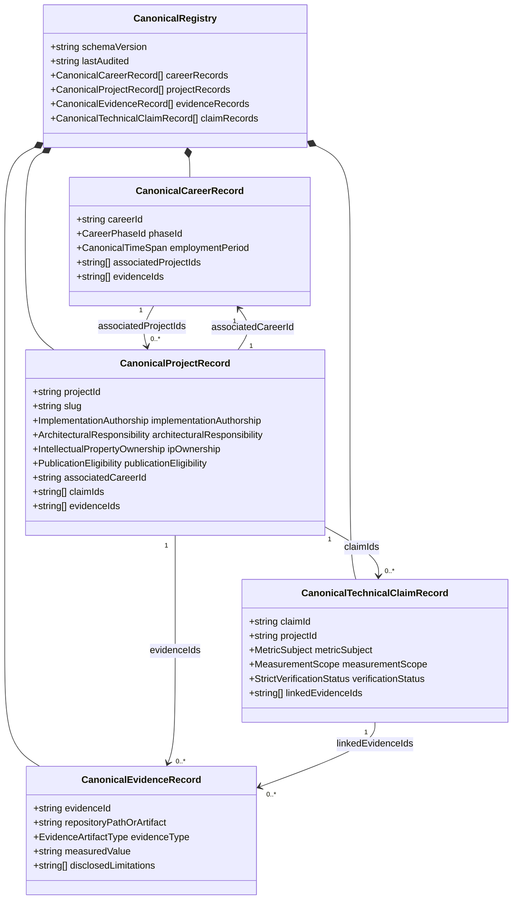
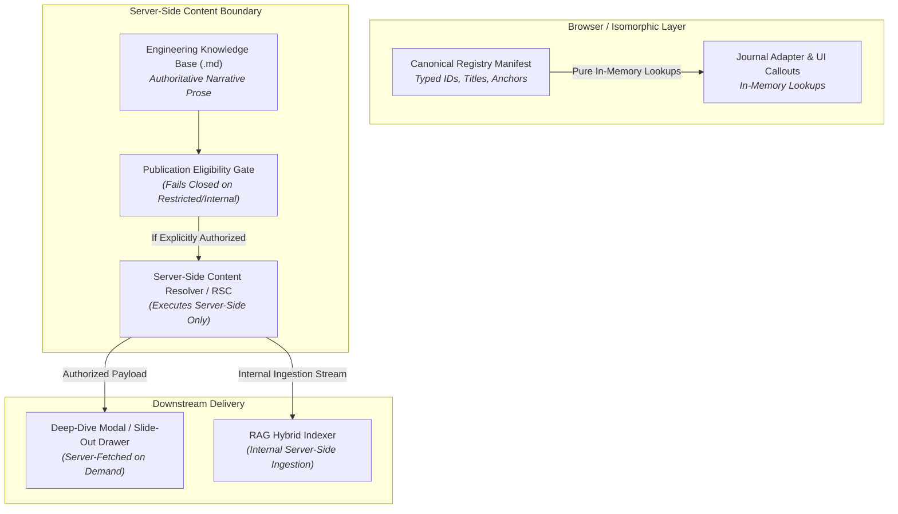

# Phase 2.5C — Canonical Case-Study Architecture Assessment & Design Refinement

**Document Type:** Architectural Evaluation & Implementation-Ready Design Proposal\
**Target Repository:** `C:\Users\HP\OneDrive\Documents\Portfolio\`\
**Branch:** `main`\
**Baseline Commit:** `445a88055a44b9d9bffb301cf144b32a2648adee`\
**Status:** FINAL ARCHITECTURE PROPOSAL READY FOR USER ACCEPTANCE\
**Execution Boundary:** Strictly documentation and architectural design. Zero schema migrations, code edits, or phase implementations applied.

---

## 1. Executive Recommendation

Following an exhaustive read-only inspection of the Portfolio repository's canonical data layer, schema definitions, validation engines, adapters, and governing knowledge base documents:

> [!IMPORTANT]
> **Primary Architectural Recommendation: Adopt Option B (Minimal Canonical Extension).**\
> - **Option A (Pure Reuse):** Inadequate. The existing canonical schema contains no typed representation of case studies (`CS-01` to `CS-08`), Architectural Decision Records (`ADR-xxx`), or granular journal-to-case-study relationship mappings. Pure reuse would force downstream consumers (Journal UI in Phase 2.5D and RAG in Phase 2.5E) to rely on brittle, untyped Markdown string parsing or heuristic slug matching without compile-time referential integrity.
> - **Option C (Dedicated Redundant Registry):** Disproportionate and hazardous. Creating an independent, monolithic TypeScript registry (such as the exploratory 768-line `engineeringCaseStudies.ts` inspected in the working tree) violates source-of-truth separation, introduces a massive dual-maintenance burden (duplicating ~50 KB of narrative prose across Markdown and TypeScript), and creates severe desynchronization risks whenever technical narratives, evidence caveats, or root causes are refined.
> - **Option B (Minimal Canonical Extension):** Optimal, robust, and strictly bounded. Adds lightweight, typed manifest references (`CanonicalCaseStudyReference`) and typed ADR manifests (`CanonicalAdrReference`) to the existing canonical registry (`canonicalRegistry.ts`). Establishes stable IDs, entity mappings, ADR pointers, and journal relationship classifications (`DIRECT` vs `PARTIAL`) without copying a single line of technical narrative into TypeScript.
>   - The Engineering Knowledge Base (`ENGINEERING_EXPERIENCE_KNOWLEDGE_BASE_DRAFT.md`) remains the sole, authoritative source of truth for technical prose, incident post-mortems, forensic analyses, and all 23 verified ADRs.
>   - The Canonical Case-Study Manifest is the sole authoritative owner of case-study-to-journal relationships; the Journal adapter derives reverse lookups dynamically.
>   - Publication eligibility strictly precedes public content generation; server-only content resolution is the default, and restricted/proprietary material remains strictly protected behind server boundaries.
>   - Phase 2.5C scope is kept strictly minimal: it models relationships, IDs, and references to *already-existing* canonical records, deferring claim/evidence reconciliation and markdown rendering engines to separately authorized phases.

---

## 2. Files and Architecture Components Inspected

The following repository components were directly inspected during this assessment:

| Category | File Path | Status in Working Tree | Lines / Size | Inspected Symbols & Roles |
|:---|:---|:---|:---|:---|
| **Governing Doc** | [`research/engineering/ENGINEERING_EXPERIENCE_KNOWLEDGE_BASE_DRAFT.md`](file:///c:/Users/HP/OneDrive/Documents/Portfolio/research/engineering/ENGINEERING_EXPERIENCE_KNOWLEDGE_BASE_DRAFT.md) | Untracked (Frozen Phase 2.5A) | 854 lines / 103 KB | Authoritative source for CS-01–CS-08, 23 verified ADRs (VOICE: 3, EDA: 4, VM: 3, REL: 4, SOLACE: 3, ETL: 3, IB: 3), 8 cross-project patterns, and metric caveat matrices. *(Note: Legacy references in earlier Phase 2.5A/2.5B narrative text to "18 ADRs" were an uncorrected typographical count originating from an earlier 6-case-study draft; direct line-by-line inspection of this frozen governing document confirms exactly 23 unique, fully documented ADR headings across CS-01 through CS-07, with CS-08 deferred).* |
| **Governing Doc** | [`research/engineering/PHASE_2_5B_JOURNAL_INTEGRATION_AND_RAG_READINESS.md`](file:///c:/Users/HP/OneDrive/Documents/Portfolio/research/engineering/PHASE_2_5B_JOURNAL_INTEGRATION_AND_RAG_READINESS.md) | Untracked (Accepted Phase 2.5B) | 434 lines / 45 KB | Defines journal integration mapping matrix, Option A/B callout specs, RAG chunking rules, and approval gates. |
| **Canonical Schema** | [`data/canonical/canonicalSchema.ts`](file:///c:/Users/HP/OneDrive/Documents/Portfolio/data/canonical/canonicalSchema.ts) | Untracked (Phase 1 Baseline) | 325 lines / 14.5 KB | Core interfaces: `CanonicalRegistry`, `CanonicalCareerRecord`, `CanonicalProjectRecord`, `CanonicalEvidenceRecord`, `CanonicalTechnicalClaimRecord`, `PublicationEligibility`. *(Note: `projectId` and `careerId` are declared as plain `string`).* |
| **Canonical Registry** | [`data/canonical/canonicalRegistry.ts`](file:///c:/Users/HP/OneDrive/Documents/Portfolio/data/canonical/canonicalRegistry.ts) | Untracked (Phase 1 Baseline) | 1,408 lines / 60.7 KB | Populated records: 7 career records, 12 project records, 13 claim records, 17 evidence records. |
| **Validator** | [`data/canonical/canonicalValidator.ts`](file:///c:/Users/HP/OneDrive/Documents/Portfolio/data/canonical/canonicalValidator.ts) | Untracked (Phase 1.2 Baseline) | 1,157 lines / 43.2 KB | Invariant engine: validates temporal integrity, claim wording, metric scopes, and cross-entity ID existence. |
| **Journal Adapter** | [`data/adapters/journalAdapter.ts`](file:///c:/Users/HP/OneDrive/Documents/Portfolio/data/adapters/journalAdapter.ts) | Untracked (Phase 2.4 Baseline) | 1,152 lines / 59.3 KB | `JournalChapterRecord`, `JournalGroundingMetadata` (23 chapters with career/project/claim/evidence links). *(Note: `JournalChapterRecord.id` is declared as plain `string`).* |
| **Journal Projection**| [`data/canonical/journalChapters.ts`](file:///c:/Users/HP/OneDrive/Documents/Portfolio/data/canonical/journalChapters.ts) | Tracked Modified | 27 lines / 1.3 KB | Canonical export projection module consuming `journalAdapter.ts`. |
| **Projects Metadata** | [`data/canonical/projectsMetadata.ts`](file:///c:/Users/HP/OneDrive/Documents/Portfolio/data/canonical/projectsMetadata.ts) | Tracked Modified | 13 lines / 470 B | Canonical export projection module for project metadata. |
| **Prior Experiment** | [`types/caseStudy.ts`](file:///c:/Users/HP/OneDrive/Documents/Portfolio/types/caseStudy.ts) | Untracked (Pre-existing) | 90 lines / 2.4 KB | `EngineeringCaseStudy` monolithic interface definition (Option C shape). |
| **Prior Experiment** | [`data/canonical/engineeringCaseStudies.ts`](file:///c:/Users/HP/OneDrive/Documents/Portfolio/data/canonical/engineeringCaseStudies.ts) | Untracked (Pre-existing) | 768 lines / 51 KB | Monolithic array copying complete narrative prose for 8 case studies (Option C shape). |
| **Prior Experiment** | [`data/adapters/engineeringCaseStudyAdapter.ts`](file:///c:/Users/HP/OneDrive/Documents/Portfolio/data/adapters/engineeringCaseStudyAdapter.ts) | Untracked (Pre-existing) | 222 lines / 7.3 KB | Resolution functions resolving monolithic case studies to canonical registry records. |

---

## 3. Existing Canonical Entity and Relationship Capabilities

### 3.1 Entity Model Inventory
The canonical foundation defined in `canonicalSchema.ts` and instantiated in `canonicalRegistry.ts` establishes four primary entity classes:



### 3.2 What the Existing Architecture Supports Directly (Established Facts)
1. **System Identity & Organizational Ground Truth:** Every system corresponding to `CS-01` through `CS-07` has a distinct, fully specified canonical project record (`proj-ask-aadil`, `proj-design-automation`, `proj-vm-copy`, `proj-ai-reliability`, `proj-solace-ai`, `proj-curriculum-etl`, `proj-item-bank`).
2. **Authorship, IP & Publication Governance:** Strict boundaries are cleanly enforced. For example, `proj-curriculum-etl` and `proj-item-bank` are codified as `EMPLOYER_PROPRIETARY` with `RESTRICTED_OR_INTERNAL_ONLY` / `EMPLOYER_PROPRIETARY_CASE_STUDY`, preventing IP exposure.
3. **Primary Evidence & Quantitative Claims:** Quantitative assertions (e.g. EDA CAD $< 10^{-6}$ volume discrepancy—measuring software-calculus consistency rather than physical CNC tolerance; Ask Aadil 172 core hardening checks and 327 broader harness assertions, distinguished from the AI Reliability Framework's 47 governance checks; Solace AI 50 mobile Jest checks) have assigned IDs and strict governance wordings.
4. **Journal Chapter Grounding:** `journalAdapter.ts` maps 23 chapters to canonical career IDs, project IDs, claim IDs, and evidence IDs through `JournalGroundingMetadata`.

### 3.3 What the Existing Architecture CANNOT Support Directly (Established Gaps)
1. **No Case Study Identity:** There is no concept of a `CaseStudy` entity or stable ID (`CS-01` through `CS-08`) in `canonicalSchema.ts` or `canonicalRegistry.ts`.
2. **No Architectural Decision Record (ADR) Identity:** The 23 ADRs (`ADR-VOICE-01` to `ADR-IB-03`) exist purely as markdown subheadings in the Knowledge Base draft. They have no canonical IDs, typed representations, or indexable presence in the canonical registry.
3. **No Granular Mapping Semantics:** While `journalAdapter.ts` links `ch-07-making-math-visual` to `proj-item-bank`, it cannot express the approved Phase 2.5B mapping distinction: SVG/TikZ visual routing is `DIRECT`, whereas Min/Max Swap stratified sampling is `PARTIAL`.
4. **No External Repository Boundary Representation for CS-08 (DiffGuard):** DiffGuard has no project record in `canonicalRegistry.ts`. If a consumer requests case study `CS-08`, existing schemas provide no representation for a project whose status is `SEPARATE_REPOSITORY — TECHNICAL CASE STUDY DEFERRED`.
5. **ID Inventory Gaps:** The Phase 1 canonical baseline currently lacks records for Item Bank claims/evidence (`CLAIM-IB-001/002`, `EVID-IB-01/02`) and micro-batching / reviewer evidence (`CLAIM-VM-002`, `CLAIM-ETL-002`).

---

## 4. Architectural Options Evaluation

### Detailed Comparison Matrix

| Evaluation Dimension | Option A: Reuse Existing Architecture | Option B: Minimal Canonical Extension (Recommended) | Option C: Dedicated Redundant Registry |
|:---|:---|:---|:---|
| **Core Concept** | Zero schema changes. Force consumers to infer case studies from `projectId`, `claimIds`, or raw Markdown regex parsing. | Add typed `CanonicalCaseStudyReference` manifest records to `canonicalSchema.ts` & `canonicalRegistry.ts`. Narrative remains strictly in Markdown. | Introduce a standalone TypeScript file (`engineeringCaseStudies.ts`) storing complete prose, problem statements, symptoms, and fixes. |
| **Source-of-Truth Integrity** | **POOR:** Divides authority between structured projects and untyped Markdown text. No single system knows case study boundaries. | **OPTIMAL:** Strict separation: Canonical Registry owns identity & relationships; Knowledge Base owns detailed technical prose & forensic narratives. | **CRITICAL FAILURE:** Violates source-of-truth. Duplicates ~50 KB of narrative text in TypeScript, creating immediate dual-maintenance hazard. |
| **Stable Identity & Referential Integrity** | **UNSUPPORTED:** No typed symbols for `CS-01`–`CS-08` or ADRs. Consumers cannot perform compile-time type checking. | **STRONG HYBRID:** Finite string-literal unions are provided for new case-study and ADR identifiers (`CaseStudyId`, `AdrId`). Existing project, career, and chapter types resolve to plain `string`; therefore, compile-time checks enforce interface structural shapes and discriminated mapping types, while actual record existence across projects, careers, chapters, claims, and evidence is enforced at runtime by `canonicalValidator.ts`. | **HIGH (LOCAL ONLY):** Strongly typed, but diverged from approved canonical nomenclature (e.g. used `case-study-ask-aadil-...` instead of `CS-01`). |
| **Evidence Traceability** | **PARTIAL:** Claims and evidence can be traced to projects, but not to specific incident reconstructions or ADRs. | **STRUCTURED AT CASE-STUDY LEVEL:** Connects journal chapters to case-study manifests and, via `relevantAdrIds`, to contained ADRs. Existing claim and evidence IDs are associated at the case-study manifest level (`canonicalClaimIds`, `canonicalEvidenceIds`). Does not establish individual ADR-to-claim or ADR-to-evidence pairwise relationships; repository anchors are conventions whose physical insertion and verification remain deferred to Phase 2.5D. | **REDUNDANT:** Re-declares claim and evidence arrays inside each monolithic case study object. |
| **Adapter Complexity** | **HIGH & FRAGILE:** Adapter must execute complex, brittle runtime regex against Markdown files to discover sections. | **LOW & DETERMINISTIC:** Pure in-memory relational resolution; Markdown content retrieved via server-side boundaries when eligible. | **HIGH:** Monolithic adapter must deserialize, sanitize, and filter giant TypeScript objects for every query. |
| **Validation Requirements** | **NONE POSSIBLE:** `canonicalValidator.ts` cannot validate entities it does not know exist. | **MODERATE & CLEAN:** Validator verifies uniqueness, project/chapter referential existence, CS-08 boundaries, career consistency, and non-empty partial aspects. | **EXPENSIVE & DUPLICATIVE:** Validator must inspect thousands of lines of TypeScript strings for forbidden words and leaked URLs. |
| **Compatibility with Existing Consumers** | **BREAKING:** UI components cannot reliably query case studies without custom heuristic parsers. | **QUALIFIED (Requires Controlled Migration):** Minimal extension, but extending `CanonicalRegistry` requires making the field optional during transition and updating strict test fixtures and constructors. | **PARALLEL SYSTEM:** Creates a third competing data store alongside `canonicalRegistry.ts` and `journalChapters.ts`. |
| **Future Structured RAG Ingestion (Phase 2.5E)** | **IMPEDED:** RAG indexer must guess chunk boundaries from unstructured Markdown text. | **STREAMLINED:** RAG indexer queries structured manifest for atomic boundaries (`CS-xx Overview`, `ADR-xxx`, `Claim Matrix`). | **CONVOLUTED:** RAG indexer must decide whether to chunk from `engineeringCaseStudies.ts` or from the Markdown file. |
| **Long-Term Maintenance Cost** | **MEDIUM-HIGH:** Silent link breaks when Markdown headings change. | **MINIMAL:** Updating technical explanations in Markdown requires ZERO TypeScript code edits. Registry changes only if relationships change. | **PROHIBITIVE:** Every single wording refinement, caveat addition, or typo fix must be manually synchronized across two large files. |

---

## 5. Exact Gaps in Existing Architecture

Inspection of `data/canonical/canonicalSchema.ts`, `canonicalRegistry.ts`, `canonicalValidator.ts`, and `journalAdapter.ts` identified the following specific architectural gaps:

### Gap 1: Absence of Case Study & ADR Schema Definitions
- **File:** `data/canonical/canonicalSchema.ts`
- **Missing Symbols:** No `CaseStudyId`, `CanonicalCaseStudyReference`, `CanonicalAdrReference`, `CaseStudyJournalMapping`, or `ExternalEvidenceReference` types.
- **Consequence:** Downstream consumers (Phase 2.5D UI callouts and Phase 2.5E RAG chunkers) cannot reference `CS-01` or `ADR-VOICE-01` in a type-safe manner.

### Gap 2: Root Registry Container Lacks Case Study Collection
- **File:** `data/canonical/canonicalSchema.ts` (lines 317–324)
- **Current Definition:**
  ```typescript
  export interface CanonicalRegistry {
    schemaVersion: string
    lastAudited: string
    careerRecords: CanonicalCareerRecord[]
    projectRecords: CanonicalProjectRecord[]
    evidenceRecords: CanonicalEvidenceRecord[]
    claimRecords: CanonicalTechnicalClaimRecord[]
  }
  ```
- **Consequence:** `canonicalRegistry` has no typed slot for case-study manifests or cross-project technical references.

### Gap 3: Journal Grounding Metadata Lacks Dynamic Case Study Reverse Lookup
- **File:** `data/adapters/journalAdapter.ts` (lines 60–90)
- **Current Status:** `JournalGroundingMetadata` has no field for case-study linkage, and the adapter provides no derived lookup function to resolve which case studies or ADRs link to a given chapter.

### Gap 4: Invariant Validator Lacks Case Study Verification Rules
- **File:** `data/canonical/canonicalValidator.ts` (lines 29–35)
- **Missing Logic:** `ValidationError.entityType` only accepts `'career' | 'project' | 'claim' | 'evidence' | 'root'`. It has no rules to verify that case-study references resolve to valid projects, valid claims, or valid journal chapters.

### Gap 5: Claim & Evidence Inventory Gaps Between Canonical Registry and Knowledge Base
- **File:** `data/canonical/canonicalRegistry.ts`
- **Discrepancies:**
  - **Item Bank:** `canonicalRegistry.ts` contains `proj-item-bank` (lines 478–537), but defines ZERO claims and ZERO evidence records for it. The Knowledge Base defines `CLAIM-IB-001/002` and `EVID-IB-01/02`.
  - **DiffGuard:** `canonicalRegistry.ts` has no project, claim, or evidence records for DiffGuard. The Knowledge Base defines `CLAIM-DIFF-001/004` and `EVID-DG-01`.
  - **Prefix Divergence:** `canonicalRegistry.ts` uses `CLAIM-EDA-xxx`, `CLAIM-SOLACE-xxx`, `CLAIM-RELIABILITY-xxx`, while the Knowledge Base draft uses `CLAIM-CAD-xxx`, `CLAIM-SOL-xxx`, `CLAIM-REL-xxx`.

---

## 6. Revised Proposed Data Model (Option B Proposal Only)

The refined Option B data model establishes lightweight manifest definitions. It introduces finite string-literal identifier types for new symbols, clarifies the typing limits of existing canonical entities, enforces strict containment ownership for ADRs, provides a structurally discriminated union for journal mappings, and defines an explicit external-reference structure for CS-08.

These proposed declarations are additions to the existing `data/canonical/canonicalSchema.ts` module, and therefore reuse its already-declared types (`PublicationEligibility`, `CanonicalProjectRecord`, `CanonicalCareerRecord`, etc.) directly in the same module scope without any self-import:

```typescript
// ============================================================================
// PROPOSED CANONICAL EXTENSIONS TO canonicalSchema.ts (PHASE 2.5C IMPLEMENTATION)
// Additions directly augmenting data/canonical/canonicalSchema.ts in-module.
// Reuses already-declared CanonicalProjectRecord, CanonicalCareerRecord, and
// PublicationEligibility directly without external or self-import statements.
// ============================================================================

/**
 * Re-used Canonical Identifier Types.
 * Note on Typing Invariants: In `canonicalSchema.ts`, `CanonicalProjectRecord.projectId`
 * and `CanonicalCareerRecord.careerId` are typed as plain `string`. Therefore, the indexed
 * access types `CanonicalProjectRecord['projectId']` and `CanonicalCareerRecord['careerId']`
 * evaluate to `string` and do NOT provide compile-time finite referential checking.
 * Actual record existence must be asserted at runtime by `canonicalValidator.ts`.
 */
export type CanonicalProjectId = CanonicalProjectRecord['projectId'] // string
export type CanonicalCareerId = CanonicalCareerRecord['careerId']   // string

/**
 * Journal Chapter Identifier Type (Plain string reference).
 * Architectural Invariant: The canonical schema layer (`canonicalSchema.ts`) represents core data contracts
 * and must NOT import or depend upon downstream adapter layers (`data/adapters/journalAdapter.ts`).
 * Adapters consume canonical schemas; schemas never consume adapters.
 * Therefore, `JournalChapterId` is declared as a plain `string` in this canonical extension proposal.
 * Referential integrity of referenced chapter IDs is verified at runtime across a clean validation
 * boundary (e.g. via higher-level parameter injection or adapter-layer verification, ensuring
 * `canonicalValidator.ts` does not import `journalAdapter.ts`).
 */
export type JournalChapterId = string // Plain string reference; referential integrity validated at runtime

/**
 * Existing Canonical Claim and Evidence Identifier Types (Compile-Time Restrictions Only).
 * Note on TypeScript Erasure and Runtime Validation:
 * - These finite unions describe existing canonical records actually present in `canonicalRegistry.ts`.
 *   They provide compile-time type safety when authoring manifests, preventing typos in IDEs and build checks.
 * - Because TypeScript types and unions are completely erased at runtime, `canonicalValidator.ts`
 *   CANNOT inspect these union definitions directly and cannot detect drift between the erased
 *   types and registry data.
 * - Runtime referential validation in `canonicalValidator.ts` operates by verifying that every ID in
 *   `manifest.canonicalClaimIds` and `manifest.canonicalEvidenceIds` exists in the actual runtime arrays:
 *   `canonicalRegistry.claimRecords` and `canonicalRegistry.evidenceRecords`.
 * - If synchronization between the declared compile-time unions and the populated registry records
 *   is desired, it can be verified via a dedicated test in `scripts/test_canonical_registry.ts`
 *   (e.g., using a static type-level check or a build-time test comparing an explicit runtime ID
 *   array against the registry records). `canonicalValidator.ts` does not perform runtime reflection
 *   on erased TypeScript unions.
 */
export type CanonicalClaimId =
  | 'CLAIM-EDA-001' | 'CLAIM-EDA-002'
  | 'CLAIM-OCR-001' | 'CLAIM-OCR-002'
  | 'CLAIM-ASK-001' | 'CLAIM-ASK-002'
  | 'CLAIM-SOLACE-001' | 'CLAIM-SOLACE-002'
  | 'CLAIM-RELIABILITY-001' | 'CLAIM-RELIABILITY-002'
  | 'CLAIM-VM-001' | 'CLAIM-WORKSHEETS-001' | 'CLAIM-ETL-001'

export type CanonicalEvidenceId =
  | 'EVID-DOC-RESUME-01' | 'EVID-SRC-JOURNAL-01' | 'EVID-SRC-PROJECTS-01' | 'EVID-SRC-GIT-01'
  | 'EVID-EDA-01' | 'EVID-EDA-02'
  | 'EVID-OCR-01' | 'EVID-OCR-02'
  | 'EVID-ASK-01' | 'EVID-ASK-02'
  | 'EVID-SOLACE-01' | 'EVID-SOLACE-02'
  | 'EVID-REL-01' | 'EVID-REL-02'
  | 'EVID-VM-01' | 'EVID-WS-01' | 'EVID-ETL-01'

/** Stable Case Study Identifiers matching Knowledge Base draft */
export type CaseStudyId =
  | 'CS-01' // Ask Aadil: Speech Recognition Streaming & Transcript Reconciliation
  | 'CS-02' // EDA CAD: Automated Geometry Verification & Material Hallucination Prevention
  | 'CS-03' // VM Copy: Deterministic Evaluation Layer & Batch Generation Hardening
  | 'CS-04' // AI Application Reliability: Formal Evaluation Harness & Regression Testing
  | 'CS-05' // Solace AI: Mobile Voice Agent Latency & Ephemeral Memory Management
  | 'CS-06' // Curriculum ETL: High-Volume Hierarchical Data Ingestion & Deterministic Row Guards
  | 'CS-07' // US Math Item Bank: Algorithmic Balance & Visual Domain Routing
  | 'CS-08' // DiffGuard: Multi-Platform Agent Review Engine (External Repository Boundary)

/**
 * Complete string-literal union covering all 23 ADRs documented in the Knowledge Base:
 * - CS-01: VOICE (3)
 * - CS-02: EDA (4)
 * - CS-03: VM (3)
 * - CS-04: REL (4)
 * - CS-05: SOLACE (3)
 * - CS-06: ETL (3)
 * - CS-07: IB (3)
 */
export type AdrId =
  | 'ADR-VOICE-01' | 'ADR-VOICE-02' | 'ADR-VOICE-03'
  | 'ADR-EDA-01'   | 'ADR-EDA-02'   | 'ADR-EDA-03'   | 'ADR-EDA-04'
  | 'ADR-VM-01'    | 'ADR-VM-02'    | 'ADR-VM-03'
  | 'ADR-REL-01'   | 'ADR-REL-02'   | 'ADR-REL-03'   | 'ADR-REL-04'
  | 'ADR-SOLACE-01'| 'ADR-SOLACE-02'| 'ADR-SOLACE-03'
  | 'ADR-ETL-01'   | 'ADR-ETL-02'   | 'ADR-ETL-03'
  | 'ADR-IB-01'    | 'ADR-IB-02'    | 'ADR-IB-03'

/** Record Governance Status vs Publication Eligibility */
export type ManifestGovernanceStatus = 'ACCEPTED' | 'SEPARATE_REPOSITORY_DEFERRED'

/**
 * Discriminated Union for Journal Relationships:
 * - Multiple mappings for the same chapter within one case study are permitted when they represent
 *   distinct, explicitly documented technical aspects (e.g. CS-07 maps Chapter 07 both DIRECTLY for
 *   visual-domain routing and PARTIALLY for stratified sampling).
 * - DIRECT mappings represent the chapter's primary domain and must NOT carry targetAspect
 *   (enforced at compile-time via `targetAspect?: never`). At most one DIRECT mapping per chapter
 *   is permitted per case study (enforced deterministically by runtime validator).
 * - PARTIAL mappings REQUIRE targetAspect to specify the distinct subsystem or aspect covered.
 *   TypeScript's `string` type does not guarantee non-emptiness; runtime validators deterministically
 *   enforce that `targetAspect.trim().length > 0` and reject duplicate normalized targetAspects for the same chapter.
 * - Semantic distinction between primary domains and partial aspects is established by documented mapping intent;
 *   the validator enforces deterministic uniqueness keys, non-emptiness, and ADR containment without speculating on NLP string overlap.
 * - Unmapped chapters have NO relationship record (no NONE records).
 */
export type CaseStudyJournalMapping =
  | {
      chapterId: JournalChapterId
      classification: 'DIRECT'
      targetAspect?: never
      relevantAdrIds: AdrId[]
    }
  | {
      chapterId: JournalChapterId
      classification: 'PARTIAL'
      targetAspect: string // Mandatory; runtime validator asserts trim().length > 0
      relevantAdrIds: AdrId[]
    }

/** Typed Architectural Decision Record (Ownership defined strictly by containment) */
export interface CanonicalAdrReference {
  adrId: AdrId
  title: string
  status: 'ACCEPTED' | 'SUPERSEDED' | 'EXTERNAL_SPEC'
  contentAnchor: string                  // Immutable anchor convention, e.g. 'adr-voice-01'
}

/** External Evidence Reference for Separate Repositories (CS-08) */
export interface ExternalEvidenceReference {
  externalRepository: string             // e.g. 'aadil-lang/diffguard'
  externalReferenceId: string            // e.g. 'EXT-DIFF-CLAIM-001', 'EXT-DIFF-EVID-01'
  referenceType: 'EXTERNAL_CLAIM' | 'EXTERNAL_EVIDENCE' | 'GOVERNANCE_DIRECTIVE'
  description: string                    // Narrative scope statement or prerequisite checklist
  verificationLocality: 'EXTERNAL_REPOSITORY'
}

/** Lightweight Manifest Record (Identity & Relational Pointers ONLY - Zero Narrative Prose) */
export interface CanonicalCaseStudyReference {
  caseStudyId: CaseStudyId
  title: string
  slug: string

  /** Project Association: null for CS-08 (enforced as runtime validator invariant, not at compile time) */
  projectId: CanonicalProjectId | null

  /** Career Association: must match project.associatedCareerId; null for CS-08 (enforced as runtime validator invariant) */
  associatedCareerId: CanonicalCareerId | null

  /** Publication & Governance Separation */
  manifestGovernanceStatus: ManifestGovernanceStatus
  publicationEligibility: PublicationEligibility

  /** Authoritative Ownership of Relationships */
  mappedJournalChapters: CaseStudyJournalMapping[]
  adrReferences: CanonicalAdrReference[]

  /** References to ALREADY-EXISTING Canonical Records Only (No unverified/missing IDs) */
  canonicalClaimIds: CanonicalClaimId[]
  canonicalEvidenceIds: CanonicalEvidenceId[]

  /** Unresolved References documented for future reconciliation (not treated as valid canonical IDs) */
  unresolvedClaimPrerequisites?: string[]
  unresolvedEvidencePrerequisites?: string[]

  /** External References: strictly for separate repositories (CS-08) */
  externalEvidenceReferences?: ExternalEvidenceReference[]

  /** Immutable Content Anchor */
  contentAnchor: string                  // e.g. 'cs-01'
}
```

### Integration into Root Registry
In `canonicalSchema.ts`, augment `CanonicalRegistry`:
```typescript
export interface CanonicalRegistry {
  schemaVersion: string
  lastAudited: string
  careerRecords: CanonicalCareerRecord[]
  projectRecords: CanonicalProjectRecord[]
  evidenceRecords: CanonicalEvidenceRecord[]
  claimRecords: CanonicalTechnicalClaimRecord[]
  caseStudyReferences?: CanonicalCaseStudyReference[] // <-- Minimal Extension (Optional for backward compatibility)
}
```

---

## 7. Explicit Source-of-Truth & Relationship Ownership Model

To eliminate dual-maintenance debt and prevent circular dependencies, ownership is established across the repository:

```
+----------------------------------------------------------------------------------------------------+
|                             SOURCE-OF-TRUTH ARCHITECTURAL BOUNDARIES                               |
+----------------------------------------------------------------------------------------------------+
  1. CANONICAL CASE-STUDY MANIFEST (`canonicalRegistry.ts:caseStudyReferences`):
     - Sole authoritative owner of case-study identity (`CS-01`–`CS-08`).
     - Sole authoritative owner of ADR identity (`ADR-xxx`) via containment.
     - Sole authoritative owner of case-study-to-journal relationships (`mappedJournalChapters`).

  2. JOURNAL ADAPTER (`data/adapters/journalAdapter.ts`):
     - Consumer of the manifest; does NOT maintain a duplicate hardcoded list of case studies.
     - Derives chapter-to-case-study relationships dynamically via reverse lookup:
       `getCaseStudiesForChapter(chapterId: JournalChapterId): DerivedChapterCaseStudyLink[]`

  3. ENGINEERING KNOWLEDGE BASE (`research/engineering/ENGINEERING_EXPERIENCE_KNOWLEDGE_BASE_DRAFT.md`):
     - Sole authoritative owner of detailed technical narratives, failure modes, symptoms,
       diagnostic reasoning, confirmed root causes, implementation code snippets, caveats, and all 23 ADRs.
     - Contains NO duplicated schema logic.

  4. CANONICAL CLAIM & EVIDENCE REGISTRY (`canonicalRegistry.ts:claimRecords / evidenceRecords`):
     - Authoritative owner of legal and factual claims, reproduction commands, and formal scopes.
+----------------------------------------------------------------------------------------------------+
```

### Relationship Ownership Invariants:
- `canonicalRegistry.caseStudyReferences[].mappedJournalChapters` is the **single source of truth** for all connections between the 8 case studies and the 23 journal chapters.
- `journalAdapter.ts` and UI components query this manifest. If a chapter (e.g. Chapter 01) has no case-study connection, it simply has zero records in `mappedJournalChapters`. No dummy `NONE` records exist.
- **CS-07 Aspect Isolation & Multi-Mapping Semantics:**
  The schema explicitly permits multiple mappings for the same chapter within a single case study when they represent distinct, explicitly documented technical aspects. CS-07 preserves two distinct, valid mappings in the manifest for `ch-07-making-math-visual`:
  1. `{ chapterId: 'ch-07-making-math-visual', classification: 'DIRECT', relevantAdrIds: ['ADR-IB-01', 'ADR-IB-02'] }`\
     *Scope:* Primary domain of the chapter (SVG/TikZ visual routing and compile validation gates).
  2. `{ chapterId: 'ch-07-making-math-visual', classification: 'PARTIAL', targetAspect: 'Min/Max Swap stratified sampling optimization across curriculum standards', relevantAdrIds: ['ADR-IB-03'] }`\
     *Scope:* Distinct subsidiary technical subsystem (psychometric item-pool stratified sampling optimization).
  Both mappings remain fully valid and unchanged in technical meaning.
- **Deterministic Validator Rules & Uniqueness Semantics:**
  To evaluate relationship integrity within `caseStudyReferences[i].mappedJournalChapters`, the runtime validator enforces deterministic structural checks:
  1. **At Most One DIRECT Mapping Per Chapter:**\
     Because `DIRECT` denotes that the case study maps to the chapter's primary domain as a unified whole, at most **one** `DIRECT` mapping is permitted per chapter within a case study. A second `DIRECT` mapping for the same chapter is deterministically rejected (`identityKey = `${m.chapterId}::DIRECT``).
  2. **Non-Empty PARTIAL Target Aspects:**\
     For all `PARTIAL` mappings, the validator asserts `typeof m.targetAspect === 'string' && m.targetAspect.trim().length > 0`.
  3. **Rejection of Duplicate Normalized PARTIAL Aspects:**\
     Multiple `PARTIAL` mappings for the same chapter are permitted only when targeting distinct aspects. The validator computes `identityKey = `${m.chapterId}::PARTIAL::${m.targetAspect.trim().toLowerCase()}`` and rejects duplicate normalized target aspects for the same chapter.
  4. **ADR Reference Integrity within Mappings:**\
     Duplicate ADR references within a single mapping (e.g. `['ADR-IB-01', 'ADR-IB-01']`) are invalid and rejected.
  5. **In-Manifest ADR Scope:**\
     Every ADR identifier in `relevantAdrIds` must resolve to an ADR defined in the `adrReferences` of the *same* case study manifest.
- **Qualification of Semantic Validation Boundaries:**\
  A runtime code validator cannot infer arbitrary semantic overlap, contradictory technical meaning, or primary-domain equivalence from free-form strings and ADR arrays alone:
  - **ADR Overlap Qualification:** Identical or overlapping `relevantAdrIds` across mappings for the same chapter must not automatically be treated as proof of conflicting classifications; an architectural decision record may legitimately inform both a chapter's primary domain and a subsidiary aspect.
  - **Domain Distinction via Documented Intent:** The semantic distinction between a `DIRECT` mapping (the chapter's primary subject matter) and a `PARTIAL` mapping (a distinct subsidiary subsystem) is governed by documented mapping intent and peer review, rather than presented as an objectively enforceable string-distance or NLP normalization check.
  - **CS-07 Preservation:** CS-07's co-existence of a DIRECT mapping (SVG/TikZ visual routing and compile validation) and a PARTIAL mapping (Min/Max Swap stratified sampling optimization) for Chapter 07 satisfies all deterministic validation criteria and preserves its documented architectural intent.
- **Sufficiency of Existing Data Model (No New Fields Needed):**
  The existing discriminated union representation (`targetAspect?: never` on `DIRECT`, `targetAspect: string` on `PARTIAL`) is fully sufficient to support these deterministic checks. Introducing redundant discriminator fields (e.g. an artificial `aspectId` or `mappingId`) is unnecessary and rejected in favor of this minimal, self-describing model.

### ADR Ownership and Reference Rules:
- ADR references are owned strictly through containment inside their parent `CanonicalCaseStudyReference.adrReferences`. No redundant `caseStudyId` property is defined on `CanonicalAdrReference`.
- **Global Uniqueness Invariant:** ADR IDs must be globally unique across all case-study manifests (no duplicate ADR IDs anywhere in the registry).
- **In-Manifest Scope Invariant:** Each mapping's `relevantAdrIds` must refer to an ADR contained within the *same* case-study manifest. Cross-case-study ADR referencing is rejected by the runtime validator.
- **Reference Integrity Invariant:** Duplicate ADR references within a single mapping (e.g. `['ADR-IB-01', 'ADR-IB-01']`) are invalid and rejected.
- **Immutability Invariant:** An ADR cannot be silently reassigned to another case study without an explicit schema migration.

### 7.3 Validator Dependency Direction & Chapter Referential Boundary
To preserve clean layering across the codebase, strict dependency directions are enforced:
- **Core Layer Independence:** The canonical schema (`canonicalSchema.ts`), canonical registry (`canonicalRegistry.ts`), and core invariant engine (`canonicalValidator.ts`) represent foundational domain models and must remain strictly independent of downstream adapter modules (`data/adapters/journalAdapter.ts`). Adapters depend on canonical data; canonical data and its core validator never depend on adapters.
- **Clean Validation Boundary for `chapterId`:**\
  `canonicalValidator.ts` must **not** import `journalAdapter.ts` merely to obtain journal chapter records. To enforce that invalid chapter references are rejected without inverting layer dependencies, Phase 2.5C specifies a clean validation boundary:
  1. *Parameter Injection Boundary:* A higher-level composition layer or test runner supplies the known valid `chapterId` collection to the validator function (e.g. as an external context parameter); OR
  2. *Adapter/Integration Validation Layer:* Cross-boundary referential validation (verifying that every `mappedJournalChapters[].chapterId` resolves to an existing chapter record) is performed in an adapter or integration test suite where canonical data and adapter data are naturally composed.
- **Referential Integrity Guarantee:** Under either design pattern, invalid chapter references are strictly rejected while keeping `canonicalValidator.ts` completely decoupled from adapter modules. (Note: This documents the architectural boundary specification for Phase 2.5C implementation; it does not invent new modules or claim that this function signature is already implemented in the current repository baseline).

---

## 8. Publication Eligibility & Server-Side Content Resolution

### 8.1 Publication Eligibility Semantics & Multi-Layer Authorization
A rigorous distinction must be maintained between internal knowledge assets and public portfolio interfaces:

```
+----------------------------------------------------------------------------------------------------+
|                                  PUBLICATION AUTHORIZATION GATE                                    |
+----------------------------------------------------------------------------------------------------+
  1. DISTINCT PUBLICATION CONCEPTS:
     - Case-Study-Level Eligibility (`caseStudy.publicationEligibility`): Defines the broad surface
       clearance for the system (e.g. `PUBLIC_OPEN_SOURCE` vs `EMPLOYER_PROPRIETARY_CASE_STUDY`).
     - Content-Chunk-Level Eligibility: Individual sections or ADRs within a case study may carry
       stricter boundaries than the overall project (e.g. high-level architecture is public, but raw
       database schemas or internal prompt strings remain restricted).
     - Authorization to Generate a Public Artifact: Permission to compile or output static artifacts
       into public directory structures (e.g. `public/generated/`).
     - Authorization to Serve Content: Permission for a server endpoint (API/RSC) to return payload
       bytes to a requesting browser client.

  2. ELIGIBILITY PRECEDES GENERATION AND SERVING:
     - Public static generation and runtime serving require explicit authorization for BOTH the
       case study AND every included content chunk.
     - `EMPLOYER_PROPRIETARY_CASE_STUDY` is NOT, by itself, blanket permission to publish arbitrary
       technical content. Only specifically approved public boundaries (high-level problem/solution
       mechanics without proprietary code, schemas, or company infrastructure) may be exposed.
     - Restricted (`RESTRICTED_OR_INTERNAL_ONLY`) material must remain completely inaccessible
       through public artifact paths and endpoints.

  3. SANITIZATION IS NOT AUTHORIZATION:
     - Sanitization, DLP scanning, regex URL scrubbers, and redactions are secondary safety nets;
       they do NOT independently authorize publication.
     - If publication eligibility is missing, conflicting, ambiguous, or restricted, the content
       resolver must FAIL CLOSED (refuse to build, compile, or serve the content).

  4. CS-08 PUBLICATION RULE:
     - CS-08 is a separate-repository case study. Its internal manifest may contain only approved
       identity and external-reference metadata.
     - Public display is strictly prohibited unless a separately authorized publication decision
       explicitly approves the exact external material to be exposed.
     - A generic external-reference view must NOT be treated as automatic publication authorization.
     - CS-08 has `publicationEligibility: 'RESTRICTED_OR_INTERNAL_ONLY'` by default.
+----------------------------------------------------------------------------------------------------+
```

### 8.2 Two-Layer Architecture: In-Memory Manifest + Server-Side Content Resolution



1. **In-Memory Relationship & Metadata Layer (Client & Server Safe):**
   - Pure, synchronous, zero-dependency functions: `getCaseStudyManifest(id: CaseStudyId)`, `getAdrManifest(adrId: AdrId)`, `getCaseStudiesForChapter(chapterId: JournalChapterId)`.
   - Runs safely in browser client components, edge runtimes, or Node.js without filesystem access.
2. **Server-Side Content Resolution Layer (Server-Side Only):**
   - **No Browser Filesystem Access:** Client components do NOT call `fs.readFileSync` or parse raw Markdown.
   - **Server Boundary Enforcement:** Content is delivered on-demand via authenticated React Server Components (RSC) or an internal API endpoint that verifies multi-layer publication eligibility before streaming content.

### 8.3 Immutable Content-Anchor Conventions & Phase 2.5D Ownership
To protect against silent link breaks when heading text is revised:
- Content references must NOT depend solely on automatically generated GitHub Flavored Markdown heading slugs (which change whenever words or punctuation are edited).
- The system adopts explicit, immutable anchor identifiers:
  - Case study anchor: `contentAnchor: 'cs-01'` (convention: `cs-xx`).
  - ADR anchor: `contentAnchor: 'adr-voice-01'` (convention: lowercase ADR ID, `adr-xxx`).
- **Phase Ownership Boundary:**
  - **Phase 2.5C Scope:** Documents the immutable anchor convention only. Phase 2.5C does NOT create, modify, or execute an anchor linter, nor does it insert anchors into the Knowledge Base.
  - **Phase 2.5D Scope:** Owns both explicit anchor insertion into `ENGINEERING_EXPERIENCE_KNOWLEDGE_BASE_DRAFT.md` and the implementation and verification of the anchor linter script (`scripts/verify_case_study_anchors.ts`). Phase 2.5D must verify that every manifest anchor resolves to exactly one source anchor before enabling content links.

---

## 9. Claim & Evidence Boundaries & Deferred Reconciliation

### 9.1 Phase 2.5C Scoping: Strictly Existing Canonical Records
To preserve repository integrity and avoid scope creep, **Phase 2.5C does NOT perform claim/evidence reconciliation or invent missing canonical records**:
- `canonicalClaimIds` and `canonicalEvidenceIds` in `CanonicalCaseStudyReference` must reference **only claim and evidence IDs already present in the accepted canonical registry** (`canonicalRegistry.ts`).
- Missing records (e.g. `CLAIM-IB-001/002`, `EVID-IB-01/02`, `CLAIM-VM-002`, `CLAIM-ETL-002`, `EVID-CAD-03`) are NOT created in Phase 2.5C.
- Existing identifiers are NOT silently renamed (e.g. `CLAIM-EDA-001` remains untouched; it is not renamed to `CLAIM-CAD-001`).
- Canonical claim and evidence wordings are NOT altered.
- DiffGuard records (`CLAIM-DIFF-001..004`, `EVID-DG-01`) are NOT registered as internal Portfolio records.
- Missing items are recorded strictly in optional diagnostic prerequisite arrays (`unresolvedClaimPrerequisites`, `unresolvedEvidencePrerequisites`) for visibility, without pretending they are validated canonical records.

### 9.2 Deferred Reconciliation Model (For Future Authorized Task)
When a future canonical reconciliation task is explicitly authorized, it must follow an unambiguous **directional resolution model**:

```
+----------------------------------------------------------------------------------------------------+
|                               DIRECTIONAL RESOLUTION ALIAS MODEL                                   |
+----------------------------------------------------------------------------------------------------+
  1. DIRECTIONALITY:
     - Directional mapping: Knowledge Base Reference -> Canonical Registry ID.
     - Model: `KB_TO_CANONICAL_CLAIM_MAP: Record<KnowledgeBaseClaimId, CanonicalClaimId>`
     - Note: `KnowledgeBaseClaimId` is used here purely as a conceptual placeholder for a type
       to be defined in a separately authorized reconciliation task. No new canonical identifier
       type is introduced and no reconciliation is performed in Phase 2.5C.
     - It is NOT bidirectional; reverse lookups are defined separately only if required.

  2. RESOLUTION SEMANTICS & ERROR BEHAVIOR:
     - Collision Handling: Permissible for multiple KB references to map to a single canonical ID
       if documented as aliases.
     - Unknown / Unresolved IDs: Fail-closed. If a KB reference has no entry in the map, the
       reconciliation engine must throw an unresolved error rather than falling back to guessing.

  3. SCOPE OF FUTURE RECONCILIATION TASK:
     - Formal authoring of missing Item Bank claims (`CLAIM-IB-001/002`) and evidence (`EVID-IB-01/02`).
     - Formal authoring of missing ETL / VM Copy secondary evidence.
     - Explicit deprecation or normalization of shortened prefixes (`CAD` vs `EDA`).
+----------------------------------------------------------------------------------------------------+
```

---

## 10. CS-08 Governance Treatment (DiffGuard External Boundary)

Case Study `CS-08` represents a critical governance boundary test for the Portfolio. The assessment establishes strict, immutable boundary rules:

1. **No Portfolio Project Record:** `CS-08` must NOT have a `projectId` in `canonicalRegistry.projectRecords`. Its manifest entry sets `projectId: null` (enforced as a runtime canonical invariant).
2. **No Career Association:** `associatedCareerId` is explicitly `null` (enforced as a runtime canonical invariant). DiffGuard was not developed under any of the 7 formal employment or freelance career records.
3. **No Historical Journal Mapping:** `mappedJournalChapters` is an explicitly empty array (`[]`). DiffGuard is not the subject of any historical journal chapter.
4. **No Internal Canonical Claims or Evidence:** `canonicalClaimIds` and `canonicalEvidenceIds` are explicitly empty (`[]`). External DiffGuard claims and evidence must NOT be registered as internal Portfolio records.
5. **Governance Status:** Fixed to `manifestGovernanceStatus: 'SEPARATE_REPOSITORY_DEFERRED'`.
6. **Publication Eligibility:** Fixed to `publicationEligibility: 'RESTRICTED_OR_INTERNAL_ONLY'`. Public display is strictly prohibited unless a separately authorized publication decision explicitly approves the exact external material to be exposed.
7. **External Evidence References:** External claims (`CLAIM-DIFF-001`..`004`) and evidence (`EVID-DG-01`) are represented strictly via `ExternalEvidenceReference[]` pointing to external repository `aadil-lang/diffguard`, completely separated from internal canonical claim arrays.

### 10.1 Compile-Time vs Runtime Boundary Guarantees for CS-08
- **Why CS-08 Null Associations Are Runtime Invariants (Not Compile-Time):**\
  In `CanonicalCaseStudyReference`, `projectId` is typed as `CanonicalProjectId | null` and `associatedCareerId` is typed as `CanonicalCareerId | null`. Because this is a single, uniform interface across all 8 case studies, TypeScript's type checker allows any case study to hold either a string or `null`. The type system does not structurally constrain `CS-08` specifically to have `projectId: null` and `associatedCareerId: null`.
- **Minimal Architectural Decision:**\
  Rather than complicating the canonical schema with a heavyweight discriminated union (e.g. splitting into `InternalCanonicalCaseStudy` vs `ExternalDeferredCaseStudy` which would complicate array consumption across the entire codebase), Option B intentionally models CS-08 using the uniform `CanonicalCaseStudyReference` interface and delegates boundary enforcement to **runtime canonical invariants** in `canonicalValidator.ts`.
- **Enforced Boundaries:**\
  The validator strictly asserts that whenever `caseStudyId === 'CS-08'`:
  - `projectId === null` (rejects any non-null project ID)
  - `associatedCareerId === null` (rejects any non-null career ID)
  - `mappedJournalChapters.length === 0` (no internal journal mappings permitted)
  - `canonicalClaimIds.length === 0` (no internal canonical claims permitted)
  - `canonicalEvidenceIds.length === 0` (no internal canonical evidence permitted)
  - `manifestGovernanceStatus === 'SEPARATE_REPOSITORY_DEFERRED'`
  - `publicationEligibility === 'RESTRICTED_OR_INTERNAL_ONLY'`
  - All external references, if present, must reside in `externalEvidenceReferences`.

---

## 11. Validation and Governance Responsibility Boundaries

To maintain software reliability and prevent responsibility entanglement, governance checks are partitioned across distinct, decoupled mechanisms:

```
+----------------------------------------------------------------------------------------------------+
|                                GOVERNANCE RESPONSIBILITY PARTITIONING                              |
+----------------------------------------------------------------------------------------------------+
  1. TYPESCRIPT COMPILE-TIME CHECKS:
     - Finite string-literal identifier unions where explicitly defined (`CaseStudyId`, `AdrId`).
     - Discriminated union structural constraints: `DIRECT` prohibits `targetAspect` (`targetAspect?: never`);
       `PARTIAL` requires `targetAspect: string`.
     - Compile-Time Union Scope & Erasure: The finite string-literal unions `CanonicalClaimId` and
       `CanonicalEvidenceId` provide compile-time syntax and typo checks during authoring, but are
       completely erased at runtime. TypeScript cannot perform runtime reflection on these unions.
     - CS-08 Null Associations Are NOT Compile-Time Enforced: In the uniform `CanonicalCaseStudyReference`
       interface, `projectId` and `associatedCareerId` allow `null` for any case study, but TypeScript does
       not structurally enforce at compile time that CS-08 specifically has null values; this boundary is
       formally defined and enforced as a runtime invariant.
     - Limits of Compile-Time Typing: Because existing project, career, and chapter identifier fields
       in `canonicalSchema.ts` and `journalAdapter.ts` are declared as plain `string`, TypeScript
       cannot verify at compile time whether a project, career, or chapter ID actually exists in the
       registry. Compile-time types guarantee structural shape only, not referential existence.

  2. RUNTIME CANONICAL INVARIANT VALIDATOR (`data/canonical/canonicalValidator.ts`):
     - Uniqueness of `CaseStudyId` across `caseStudyReferences`.
     - Uniqueness of `AdrId` across all nested ADR manifests across the complete registry.
     - Referential existence against actual registry arrays: verifies that referenced `projectId`,
       `associatedCareerId`, `canonicalClaimIds`, and `canonicalEvidenceIds` exist in
       `canonicalRegistry.projectRecords`, `canonicalRegistry.careerRecords`, `canonicalRegistry.claimRecords`,
       and `canonicalRegistry.evidenceRecords`.
     - Chapter Referential Validation Boundary: `canonicalValidator.ts` must NOT import `journalAdapter.ts`
       merely to obtain journal chapter records. A clean boundary is maintained: valid chapter IDs are supplied
       by a higher-level composition/runner layer to the validator, or chapter referential checks are executed in
       an adapter/integration validation layer. In all cases, invalid `chapterId` references are strictly rejected.
       The validator does NOT inspect erased TypeScript unions directly and does NOT detect union drift at runtime
       (union synchronization, if required, is verified in static test suites like `scripts/test_canonical_registry.ts`).
     - Deterministic Journal Mapping Validation:
       - Multi-mapping allowance: Multiple mappings for the same chapter within one case study are
         permitted when representing distinct technical aspects (e.g. CS-07's DIRECT visual routing and
         PARTIAL stratified sampling).
       - At most one DIRECT mapping per chapter per case study (`${chapterId}::DIRECT`).
       - Non-empty PARTIAL target aspect: asserts `typeof mapping.targetAspect === 'string' && mapping.targetAspect.trim().length > 0`.
       - Duplicate normalized PARTIAL aspect rejection: evaluates
         `${chapterId}::PARTIAL::${targetAspect.trim().toLowerCase()}`.
       - Duplicate ADR reference rejection within a mapping (`relevantAdrIds`).
       - In-manifest ADR scope: asserts every ID in `relevantAdrIds` exists in the same manifest's `adrReferences`.
       - Semantic Qualification: The validator enforces deterministic identity keys, array membership, and
         string non-emptiness. It does NOT attempt to infer natural-language semantic overlap or primary-domain
         equivalence from strings alone, nor does it treat identical `relevantAdrIds` as conflicting classifications;
         semantic distinction between primary domains and partial aspects is established by documented mapping intent.
     - Project-Career consistency: asserts `caseStudy.associatedCareerId === project.associatedCareerId`.
     - CS-08 external boundary invariants: strictly asserted at runtime: `projectId === null`,
       `associatedCareerId === null`, `mappedJournalChapters.length === 0`, `canonicalClaimIds.length === 0`,
       `canonicalEvidenceIds.length === 0`, `manifestGovernanceStatus === 'SEPARATE_REPOSITORY_DEFERRED'`,
       and `publicationEligibility === 'RESTRICTED_OR_INTERNAL_ONLY'`.
     - Presence of valid `publicationEligibility` and `manifestGovernanceStatus` enum values.
     - Legacy Collection Invariant: distinguishes a deliberately absent legacy collection
       (`caseStudyReferences === undefined`) from a populated but invalid collection.
     - Note: Arbitrary string-length thresholds (e.g. `> 250 chars`) are EXPLICITLY REJECTED as a
       substitute for real validation.

  3. CONTENT RESOLVER & ANCHOR LINTER (DEFERRED TO PHASE 2.5D):
     - Build-time / CI verification of Markdown content anchors.
     - Verifies that `contentAnchor` for every case study and ADR resolves to an exact anchor marker
       in `ENGINEERING_EXPERIENCE_KNOWLEDGE_BASE_DRAFT.md`.
     - Owned by Phase 2.5D; excluded from Phase 2.5C scope.

  4. CONFIDENTIALITY & PUBLICATION GOVERNANCE (DEFERRED TO PHASE 2.5D/2.5E):
     - Independent data-loss prevention and IP protection.
     - Validates that `publicationEligibility` permits public exposure before content generation.
     - Independent AST inspection and string scanning for proprietary corporate URLs
       (`github.com/wayground/...`, `github.com/quizizz/...`).
     - Mandatory execution of `sanitizeRetrievalEvidence()` on all retrieved content chunks.
+----------------------------------------------------------------------------------------------------+
```

---

## 12. Revised Downstream Integration Model (Phases 2.5D & 2.5E)

### 12.1 Phase 2.5D: Journal Technical Deep-Dive Cross-Referencing
- **Zero Prose Rewrites:** Biographical narratives in `journalChapters.ts` remain 100% untouched.
- **Dynamic Derived Links:** At the bottom of a chapter page (e.g. Ch. 07, 11, 12, 15, 18, 19, 21, 22), the rendering component executes:
  ```typescript
  const deepDiveLinks = getCaseStudiesForChapter(chapter.id)
  ```
- **UI Presentation:** The component renders a `<TechnicalDeepDiveCallout>` displaying the case-study title, relationship badge (`Direct Technical Mapping` or `Partial Domain Mapping`), and relevant ADR badges (`ADR-VOICE-01`).
- **Server-Gated Content Loading:** Clicking an ADR or Deep-Dive link triggers an on-demand server fetch through the authorized publication gate, ensuring restricted materials are never loaded into client browsers.

### 12.2 Phase 2.5E: Structured RAG Knowledge Ingestion
- **Tripartite Ingestion Pipeline:**
  1. **Manifest Layer:** Provides the deterministic semantic chunk skeleton (Case Study Overview, ADRs, Incident Diagnostics, Claim Matrix).
  2. **Knowledge Base Layer:** Provides the authoritative technical narrative prose, problem analysis, and resolution details.
  3. **Canonical Claim & Evidence Layer:** Supplies formal verification statuses, reproduction commands, and governed caveat wordings.
- **Dual-Source Caveat Binding Rule:**\
  *Crucial Architecture Correction:* Canonical claims do NOT automatically contain every forensic caveat documented in the Knowledge Base. For example, the Knowledge Base documents that VM Copy's $<1\text{ms}$ evaluator applies strictly to Tier-1 regex/AST checks while generative LLM synthesis takes 4–8 seconds (historical observation), and EDA CAD's $<10^{-6}$ volume agreement measures software-calculus consistency rather than physical CNC tolerance.\
  Therefore, the RAG chunking pipeline in Phase 2.5E must perform **dual-source caveat binding**: it extracts the mandatory forensic caveat from the Knowledge Base section text *and* links it to the canonical claim record, embedding both caveats directly into the chunk text so they cannot be stripped during LLM prompt assembly.

---

## 13. Compatibility Analysis, Phase Scoping, and Explicit Non-Goals

### 13.1 Qualified Compatibility Analysis (Option B Extension)
Extending `CanonicalRegistry` with `caseStudyReferences` is the smallest possible modification, but it is **not unconditionally non-breaking** for strict consumers:
- **Impact on Fixtures & Tests:** Unit test suites (e.g. `scripts/test_canonical_registry.ts`) and mock factories constructing `CanonicalRegistry` objects may fail TypeScript compilation if the new property is declared as mandatory.
- **Implementation Migration Safeguards:**
  1. Declare `caseStudyReferences?: CanonicalCaseStudyReference[]` as an **optional property** on `CanonicalRegistry` during the migration period.
  2. Registry loaders must normalize an absent collection to an empty array (`canonicalRegistry.caseStudyReferences ?? []`) for consumers that require iteration.
  3. The runtime validator must distinguish a deliberately absent legacy collection from a populated but invalid collection.
  4. Existing fixtures and constructors (e.g. in test suites) will require controlled updates during implementation.
  5. Schema version changes are an implementation decision to be made after inspecting actual repository versioning conventions, not an assumed automatic version bump.

### 13.2 Strict Phase 2.5C Implementation Scope
To ensure strict delivery boundaries, Phase 2.5C implementation will cover **ONLY**:
1. Canonical schema extensions (`CanonicalCaseStudyReference`, `CanonicalAdrReference`, `CaseStudyJournalMapping`, `ExternalEvidenceReference`) in `canonicalSchema.ts`.
2. Finite string-literal identifier types (`CaseStudyId`, `AdrId`).
3. Manifest population in `canonicalRegistry.ts` referencing **existing** project, claim, and evidence records.
4. CS-08 external boundary manifest entry.
5. Runtime invariant validator suite in `canonicalValidator.ts` (enforcing canonical invariants, with chapter referential validation designed across a clean boundary without importing `journalAdapter.ts`).
6. Dynamic reverse-lookup helper (`getCaseStudiesForChapter`) in `journalAdapter.ts`.

### 13.3 Explicitly Deferred to Downstream Phases (Separately Authorized)
The following items are **explicit non-goals for Phase 2.5C** and are deferred to downstream phases:
- **Deferred to Future Reconciliation Task:** Adding missing Item Bank claims/evidence to `canonicalRegistry.ts`, directional alias mapping execution, and canonical claim wording changes.
- **Deferred to Phase 2.5D:** Explicit anchor insertion into the Knowledge Base, anchor linter script implementation (`scripts/verify_case_study_anchors.ts`), Markdown AST parsing, server component content streaming, and slide-out drawer UI development.
- **Deferred to Phase 2.5E:** RAG knowledge chunking, dual-source caveat embedding, and hybrid retriever indexing.
- **Permanent Non-Goals:** Writing code for DiffGuard in this repository, rewriting journal prose, and duplicating narrative text in TypeScript.

---

## 14. Final Architectural Verdict

```
+----------------------------------------------------------------------------------------------------+
|                                    FINAL ARCHITECTURAL VERDICT                                     |
+----------------------------------------------------------------------------------------------------+
  1. REUSE EXISTING ARCHITECTURE (OPTION A):             REJECTED (Insufficient; untyped & fragile)
  2. DEDICATED REDUNDANT REGISTRY (OPTION C):            REJECTED (Hazardous; dual-maintenance debt)
  3. MINIMAL CANONICAL EXTENSION (OPTION B):             RECOMMENDED FOR PHASE 2.5C IMPLEMENTATION
+----------------------------------------------------------------------------------------------------+
```

**Justification:**\
Refined Option B represents the smallest, cleanest, and most robust architecture capable of supporting stable case-study references. It establishes strict compile-time structural typing and runtime referential integrity across projects, manifest-level claims and evidence, ADR containment, and journal relationships while rigorously protecting source-of-truth separation:
- **Canonical Registry:** Owns stable identity, entity mappings, ADR containment, manifest-level claim/evidence pointers, and journal relationships (without overclaiming individual ADR-to-claim or ADR-to-evidence pairwise links).
- **Engineering Experience Knowledge Base:** Owns deep technical narratives, failure modes, incidents, forensic analyses, and all 23 verified ADRs.
- **Publication Gate & Server Resolver:** Ensures content resolution is server-gated, fail-closed, and strictly controlled by publication eligibility.

---

```
PHASE 2.5C — FINAL ARCHITECTURE PROPOSAL READY FOR USER ACCEPTANCE
```