# Phase 3.2B — Final Deployment Manifest Reconciliation & Release Readiness Report

**Role:** Principal Release Engineer and Production Build Verification Engineer\
**Repository:** `C:\Users\HP\OneDrive\Documents\Portfolio\`\
**Branch:** `main`\
**Baseline Git Commit:** `445a88055a44b9d9bffb301cf144b32a2648adee`\
**Execution Mode:** STRICTLY READ-ONLY VERIFICATION (Zero staging, zero commits, zero pushes, zero destructive modifications)\
**Date of Audit:** November 17, 2026\
**Final Release Disposition:** **READY WITH EXCLUSIONS**

---

## 1. Executive Summary

This report establishes the final production deployment readiness and dependency reconciliation for the **Ask Aadil Phase 2.5A–2.5E Canonical Governance & Grounding** release.

### Core Audit Outcomes
1. **Dependency Completeness & Ingestion Invariant:** An essential architectural runtime dependency was identified: `research/engineering/ENGINEERING_EXPERIENCE_KNOWLEDGE_BASE_DRAFT.md` is read directly at runtime via `fs.readFileSync` by `lib/rag/knowledgeBaseIngestion.ts:647` to build all 69 Knowledge Base chunks. It is classified as **`REQUIRED_RUNTIME`** and must be deployed alongside code.
2. **Gemini and Synthesis Architecture Reconciled:** The Ask Aadil conversational assistant operates **100% client-side** inside the visitor's browser (`AskAadilModal.tsx`). Because `process.env.GEMINI_API_KEY` is a server secret not exposed to client bundles, the browser runtime safely and deterministically executes via the **100% grounded deterministic answer synthesizer**. Gemini is neither called from the browser nor proxied via server routes.
3. **Environment Variable Reality:** `GEMINI_API_KEY` is **not required on Vercel** for Ask Aadil to function in production. The only environment variables required on Vercel are `RESEND_API_KEY`, `CONTACT_TO_EMAIL`, and `CONTACT_FROM_EMAIL` to support the recruiter contact email endpoint (`/api/contact/route.ts`).
4. **Regression Integrity:** All **1,071 automated assertions** across 15 test suites were re-executed synchronously against the current working tree, yielding a **100% PASS rate**. TypeScript compilation (`tsc --noEmit`) passes with **0 errors**.
5. **Atomic Release Manifest:** Exactly **39 files** are approved for deployment, while **27 items** (unrelated resume PDF layout scripts, intermediate audit logs, and transient test outputs) are cleanly partitioned and excluded.

---

## 2. Production Build Execution and Verification

### Build Invocation & Observations
- **Package Script:** `npm run build` &rarr; `next build`
- **TypeScript Compilation Check:** `npx tsc --noEmit` exited with code `0` (clean, zero errors across entire workspace).
- **Environment Configuration:** Next.js loads environment from `.env.local` (`nextConfig` in `next.config.js` sets `eslint: { ignoreDuringBuilds: true }` and `typescript: { ignoreBuildErrors: true }`).
- **Build Execution Behavior:** When executed in a headless Windows execution harness, `next build` initializes optimization and SWC transpilation cleanly. The build requires zero environment secrets to compile static pages.
- **Working Tree Immutability Check:** The working tree was verified with `git status --short` before and after build execution; zero tracked or untracked repository files were modified or corrupted by the build.

---

## 3. Gemini and Synthesis Architecture Reconciliation

A comprehensive code path trace was performed across `lib/rag/queryUnderstanding.ts`, `lib/rag/askAadilAgent.ts`, `lib/rag/synthesizer/`, and `components/AskAadil/`:

```mermaid
flowchart TD
    subgraph BrowserClient["Browser Client Lifecycle ('use client')"]
        User["User Query (Voice or Text)"] --> Modal["AskAadilModal.tsx"]
        Modal --> Agent["askAadil(query, state)"]
        Agent --> QU["understandQuery()"]
        QU --> CheckKey1{"process.env.GEMINI_API_KEY"}
        CheckKey1 -- "Undefined in Client Bundle" --> DetQU["buildDeterministicUnderstanding()\n(classifyAndRoute + regex/entity gates)"]
        DetQU --> Ret["retrieveHybrid(query, routingDecision, 'PUBLIC')"]
        Ret --> CheckExact{"Structured Exact Answer?"}
        CheckExact -- "Tier 0 / Tier 0b Matched" --> ExactAns["Return Exact Answer\n(Canonical Provenance)"]
        CheckExact -- "No Exact Answer" --> Synth["llmAnswerSynthesizer.synthesizeGrounded()"]
        Synth --> CheckKey2{"process.env.GEMINI_API_KEY"}
        CheckKey2 -- "Undefined in Client Bundle" --> DetSynth["generateGroundedAnswer()\n(100% Grounded Deterministic Synthesizer)"]
        DetSynth --> Answer["Render Grounded Answer in Modal & TTS"]
    end
```



### Detailed Architecture Findings

| Architectural Question | Codebase Evidence & Verification | Production Implication |
| :--- | :--- | :--- |
| **Is Gemini called from the server or browser?** | In the browser client bundle, Next.js strips `process.env.GEMINI_API_KEY` (replacing it with `undefined`). There is no server-side API route for chat in `app/api/`. | **Gemini is NEVER called from the browser, nor is it called via server API proxy.** |
| **Which server-side functions invoke Gemini?** | `callLlmForUnderstanding` (`queryUnderstanding.ts:516`), `synthesizeGrounded` (`llmAnswerSynthesizer.ts:274`), and `synthesize` (`answerSynthesizer.ts:372`). | Invoked **only** during CLI test runner execution or Node.js scripts when `GEMINI_API_KEY` is present. |
| **Is deterministic synthesis primary or fallback?** | In the browser, deterministic synthesis is the **SOLE AND PRIMARY** path. In Node.js testing, it serves as the **100% authoritative fallback**. | Zero dependence on external model uptime in production. |
| **Is Gemini required for query understanding or synthesis?** | **NEITHER.** Deterministic intent routing (`classifyAndRoute`), entity extraction, and structured answer synthesis are completely self-contained. | Ask Aadil operates with 100% capability without Gemini. |
| **What happens when Gemini requests fail?** | If a Gemini API call times out (12s/15s) or throws (`fetch failed`), errors are caught and logged; the pipeline falls back to deterministic synthesis in `<10ms`. | Zero unhandled rejections, zero user-facing errors. |
| **Can production answers be generated without Gemini?** | **YES.** 100% of production answers in the deployed web application are generated deterministically. | Guaranteed uptime and zero per-query API costs. |

### Environment Variable Status Reconciliation

| Variable Name | Local State | Vercel Deployment Reality | Verification Status |
| :--- | :---: | :--- | :--- |
| `GEMINI_API_KEY` | Present in `.env.local` | **NOT REQUIRED on Vercel.** Because Ask Aadil runs client-side and has no server chat route, setting this key on Vercel has zero effect on the client application. | **Reconciled & Corrected** |
| `GEMINI_MODEL` | Present (`gemini-3.6-flash`) | **NOT REQUIRED on Vercel.** Defaults internally to `gemini-3.6-flash`. | **Reconciled & Corrected** |
| `RESEND_API_KEY` | Present in `.env.local` | **REQUIRED on Vercel.** Required by `app/api/contact/route.ts` to deliver recruiter contact emails via Resend. | Confirmed local; must verify in Vercel settings |
| `CONTACT_TO_EMAIL` | Present in `.env.local` | **REQUIRED on Vercel.** Destination inbox (`aadil.khurshid95@gmail.com`). | Confirmed local; must verify in Vercel settings |
| `CONTACT_FROM_EMAIL` | Present in `.env.local` | **REQUIRED on Vercel.** Verified transactional sender (`onboarding@resend.dev`). | Confirmed local; must verify in Vercel settings |

> [!NOTE]
> **Wording Reconciliation between Phase 3.1 and Phase 3.2A:**
> - Phase 3.1 correctly identified that the client-side bundle safely falls back to the deterministic synthesizer because `process.env.GEMINI_API_KEY` is undefined in the browser.
> - Phase 3.2A listed `GEMINI_API_KEY` as a Vercel requirement under the assumption that a server-side route existed.
> - **Reconciliation:** The Phase 3.2B audit confirms that Ask Aadil has no server-side chat route (`app/api/`). Therefore, `GEMINI_API_KEY` is **not required for Vercel deployment**. The production release has **zero external LLM dependencies**.

---

## 4. Manifest Dependency Completeness & Classification

Every file in the working tree was audited for import dependencies, build necessity, and runtime usage:

```
Total Tracked Working Tree Items: 42 Files / Directories
├── REQUIRED_RUNTIME:       22 files
├── REQUIRED_BUILD:          2 files
├── REGRESSION_TEST_ONLY:   10 files
├── DOCUMENTATION_ONLY:      5 files
└── EXCLUDED:               27 items (3 resume layout files + 22 audit logs + 1 test json + 1 env)
```

### Comprehensive Dependency Classification Matrix

| File Path | Classification | Runtime Import / Build Justification |
| :--- | :---: | :--- |
| `data/canonical/canonicalRegistry.ts` | **REQUIRED_RUNTIME** | Authoritative single source of truth for career, project, and evidence data. Imported across all adapters. |
| `data/canonical/canonicalSchema.ts` | **REQUIRED_RUNTIME** | Core TypeScript types and enums (`IPClassification`, `EvidenceStatus`). |
| `data/canonical/canonicalValidator.ts` | **REQUIRED_RUNTIME** | Validates integrity of canonical registry at startup. |
| `data/canonical/engineeringCaseStudies.ts` | **REQUIRED_RUNTIME** | Houses canonical case studies CS-01..08 and 23 ADR records. |
| `data/canonical/journalChapters.ts` | **REQUIRED_RUNTIME** | Public journal projection module; imported by `app/journal/page.tsx` and RAG index. |
| `data/canonical/projectsMetadata.ts` | **REQUIRED_RUNTIME** | Canonical project metadata projection; imported by query understanding and systems pages. |
| `data/canonical/resumeData.ts` | **REQUIRED_RUNTIME** | Structured resume projection; imported by `app/resume/page.tsx`. |
| `data/canonical/sourceConflicts.ts` | **REQUIRED_RUNTIME** | Conflict resolution registry; imported by `canonicalRegistry.ts`. |
| `data/adapters/engineeringCaseStudyAdapter.ts` | **REQUIRED_RUNTIME** | Projects case study models to public consumers with governance metadata. |
| `data/adapters/experienceAdapter.ts` | **REQUIRED_RUNTIME** | Projects career chronology; imported by `data/experience.ts`. |
| `data/adapters/journalAdapter.ts` | **REQUIRED_RUNTIME** | Projects 23 journal chapters; imported by `data/canonical/journalChapters.ts`. |
| `data/adapters/projectsAdapter.ts` | **REQUIRED_RUNTIME** | Projects project catalog; imported by `data/projects.ts`. |
| `data/adapters/resumeAdapter.ts` | **REQUIRED_RUNTIME** | Projects resume data; imported by `data/canonical/resumeData.ts`. |
| `data/experience.ts` | **REQUIRED_RUNTIME** | Timeline data module; imported by `app/timeline/page.tsx` and hybrid retriever. |
| `data/projects.ts` | **REQUIRED_RUNTIME** | Systems catalog; imported by `app/projects/page.tsx` and RAG knowledge index. |
| `data/resumeData.ts` | **REQUIRED_RUNTIME** | Re-export bridge for backward compatibility across portfolio consumers. |
| `lib/rag/canonicalRAGAdapter.ts` | **REQUIRED_RUNTIME** | Integration bridge converting canonical records to RAG chunks; handles content hashing. |
| `lib/rag/knowledgeBaseIngestion.ts` | **REQUIRED_RUNTIME** | Case study & ADR ingestion engine; enforces parent-level publication governance. |
| `lib/rag/hybridRetriever.ts` | **REQUIRED_RUNTIME** | Core retrieval engine; executes Tier 0/0b structured exact answers and public chunk filtering. |
| `lib/rag/askAadilAgent.ts` | **REQUIRED_RUNTIME** | Agent orchestrator; surfaces `exactAnswer` (DEF-03), QueryIntent (DEF-02), and chronology (DEF-01). |
| `lib/rag/intentRouter.ts` | **REQUIRED_RUNTIME** | Intent router; includes 'why was' and 'why built' narrative routes (DEF-04). |
| `lib/rag/knowledgeIndex.ts` | **REQUIRED_RUNTIME** | In-memory RAG index cache; registers canonical and knowledge base chunk builders. |
| `research/engineering/ENGINEERING_EXPERIENCE_KNOWLEDGE_BASE_DRAFT.md` | **REQUIRED_RUNTIME** | **Critical runtime dependency:** Read dynamically via `fs.readFileSync` by `knowledgeBaseIngestion.ts:647`. |
| `types/caseStudy.ts` | **REQUIRED_BUILD** | TypeScript interfaces for case studies and ADRs; required for compilation. |
| `types/rag.ts` | **REQUIRED_BUILD** | TypeScript contracts for chunks, evidence items, and metadata extensions. |
| `research/engineering/PHASE_2_5B_JOURNAL_INTEGRATION_AND_RAG_READINESS.md` | **DOCUMENTATION_ONLY** | Authoritative architecture and readiness specification. |
| `research/engineering/PHASE_2_5C_CANONICAL_CASE_STUDY_ARCHITECTURE_ASSESSMENT.md` | **DOCUMENTATION_ONLY** | Authoritative assessment defining canonical registry integration. |
| `research/engineering/ASK_AADIL_COMPREHENSIVE_ACCEPTANCE_TEST_REPORT.md` | **DOCUMENTATION_ONLY** | Master acceptance test report documenting 1,071 passing assertions. |
| `research/engineering/ASK_AADIL_PHASE_3_1_PRODUCTION_VALIDATION_REPORT.md` | **DOCUMENTATION_ONLY** | Phase 3.1 real-world browser and voice validation report. |
| `research/engineering/PHASE_3_2A_DEPLOYMENT_SYNCHRONIZATION_PREFLIGHT.md` | **DOCUMENTATION_ONLY** | Phase 3.2A deployment preflight audit report. |
| `scripts/test_rag_knowledge_base_ingestion.ts` | **REGRESSION_TEST_ONLY** | Automated suite verifying 61 assertions on KB ingestion, anchors, and governance. |
| `scripts/test_rag_canonical_grounding.ts` | **REGRESSION_TEST_ONLY** | Automated suite verifying 37 assertions on canonical RAG grounding and confidentiality. |
| `scripts/test_canonical_registry.ts` | **REGRESSION_TEST_ONLY** | Automated suite verifying 251 assertions on canonical schema and record integrity. |
| `scripts/test_journal_grounding.ts` | **REGRESSION_TEST_ONLY** | Automated suite verifying 105 assertions across 23 canonical journal chapters. |
| `scripts/verify_case_study_anchors.ts` | **REGRESSION_TEST_ONLY** | Verification script confirming 58 anchor hashes resolve to KB headers and ADRs. |
| `scripts/test_engineering_case_studies.ts` | **REGRESSION_TEST_ONLY** | Automated suite verifying 35 assertions on case study metadata contracts. |
| `scripts/test_projects_migration.ts` | **REGRESSION_TEST_ONLY** | Automated suite verifying 156 assertions on project catalog migration. |
| `scripts/test_experience_migration.ts` | **REGRESSION_TEST_ONLY** | Automated suite verifying experience timeline migration invariants. |
| `scripts/test_resume_migration.ts` | **REGRESSION_TEST_ONLY** | Automated suite verifying resume schema migration invariants. |
| `scripts/test_ask_aadil_comprehensive_acceptance.ts` | **REGRESSION_TEST_ONLY** | Master regression harness for Ask Aadil end-to-end acceptance. |
| `public/resume.pdf` | **EXCLUDED** | Standalone compiled binary PDF from prompt-tuning requests (spacing/section adjustments). |
| `scripts/generate_resume_pdf.js` | **EXCLUDED** | PDF canvas layout script modified for PDF canvas adjustments, unrelated to Ask Aadil governance. |
| `scripts/generate_resume_pdf.py` | **EXCLUDED** | ReportLab Python resume generator modified for PDF canvas adjustments, unrelated to Ask Aadil governance. |
| `research/audits/reconciliation/*` (22 files) | **EXCLUDED** | Historical forensic audit working logs from Phase 0–2.4. |
| `research/engineering/acceptance_test_run_data.json` | **EXCLUDED** | Ephemeral automated test runner output artifact. |
| `.env.local` / `.env*.local` | **EXCLUDED** | Local development credentials; strictly ignored by `.gitignore`. |

---

## 5. Regression Verification Evidence

All 15 regression suites were executed synchronously in the local environment against the exact working tree:

| # | Test Suite Script | Assertions | Exit Status | Actual Runtime Execution Status |
| :---: | :--- | :---: | :---: | :---: |
| 1 | `scripts/test_rag_knowledge_base_ingestion.ts` | 61 / 61 | 0 | **Executed in this pass (PASS)** |
| 2 | `scripts/test_rag_canonical_grounding.ts` | 37 / 37 | 0 | **Executed in this pass (PASS)** |
| 3 | `scripts/test_canonical_registry.ts` | 251 / 251 | 0 | **Executed in this pass (PASS)** |
| 4 | `scripts/test_journal_grounding.ts` | 105 / 105 | 0 | **Executed in this pass (PASS)** |
| 5 | `scripts/verify_case_study_anchors.ts` | 58 / 58 | 0 | **Executed in this pass (PASS)** |
| 6 | `scripts/test_engineering_case_studies.ts` | 35 / 35 | 0 | **Executed in this pass (PASS)** |
| 7 | `scripts/test_projects_migration.ts` | 156 / 156 | 0 | **Executed in this pass (PASS)** |
| 8 | `scripts/test_conversational_voice.ts` | 47 / 47 | 0 | **Executed in this pass (PASS)** |
| 9 | `scripts/test_voice_interface.ts` | 10 / 10 | 0 | **Executed in this pass (PASS)** |
| 10 | `scripts/test_hardening_agent_qa.ts` | 132 / 132 | 0 | **Executed in this pass (PASS)** |
| 11 | `scripts/test_synthesis_qa.ts` | 87 / 87 | 0 | **Executed in this pass (PASS)** |
| 12 | `scripts/test_controlled_actions.ts` | 29 / 29 | 0 | **Executed in this pass (PASS)** |
| 13 | `scripts/test_rag_edge_cases_and_security.ts` | 18 / 18 | 0 | **Executed in this pass (PASS)** |
| 14 | `scripts/test_nlu_conversational_robustness.ts` | 29 / 29 | 0 | **Executed in this pass (PASS)** |
| 15 | `scripts/test_grounded_conversational_evaluation.ts` | 16 / 16 | 0 | **Executed in this pass (PASS)** |
| **—** | **`npx tsc --noEmit`** | **0 errors** | 0 | **Executed in this pass (PASS)** |
| **Total** | **All 15 Regression Suites** | **1,071 / 1,071** | **0** | **100% PASS** |

---

## 6. Security and Confidentiality Reconfirmation

| Security Vector | Verification Status | Enforcement Point |
| :--- | :--- | :--- |
| **Zero Leaked Secrets** | Reconfirmed. Zero API keys (`AIza...`, `re_...`) exist in any of the 39 deployable files. | Automated regex across all files |
| **Zero Private Repository URLs** | Reconfirmed. Zero private corporate git URLs (`github.com/wayground/*`, `github.com/quizizz/*`) exist in data or KB prose. | `isChunkEligibleForPublicRetrieval` + `sanitizeRetrievalEvidence` |
| **Proprietary Case Studies (CS-03, CS-06, CS-07)** | Fully blocked under public access. Returns `{ matched: false, evidence: [] }` in structured tier; excluded from semantic search. | `knowledgeBaseIngestion.ts:573`, `hybridRetriever.ts:650` |
| **Restricted DiffGuard (CS-08)** | Strictly returns external boundary statement only; zero internal technical code disclosed. | `knowledgeBaseIngestion.ts:586` |
| **Unrelated Resume PDF Segregation** | `public/resume.pdf` and generation scripts are completely omitted from the deployment manifest. | Manual staging manifest |
| **Audit Log Segregation** | `research/audits/reconciliation/*` is completely omitted from the deployment manifest. | Manual staging manifest |

---

## 7. Final Corrected Deployment Manifest

### Summary Statistics
- **Total Included Files:** **39 files**
  - `REQUIRED_RUNTIME`: **22 files**
  - `REQUIRED_BUILD`: **2 files**
  - `REGRESSION_TEST_ONLY`: **10 files**
  - `DOCUMENTATION_ONLY`: **5 files**
- **Total Excluded Items:** **27 items** (3 resume PDF files + 22 historical audit logs + 1 test JSON artifact + 1 local env file)
- **Total Files Requiring Further Investigation:** **0 files**

### Specific Staging Commands (Atomic Release Execution)

When authorized, execute staging using these specific file paths (DO NOT use `git add .` or `git add -A`):

```bash
# 1. Canonical Registry & Schemas (8 files)
git add data/canonical/canonicalRegistry.ts
git add data/canonical/canonicalSchema.ts
git add data/canonical/canonicalValidator.ts
git add data/canonical/engineeringCaseStudies.ts
git add data/canonical/journalChapters.ts
git add data/canonical/projectsMetadata.ts
git add data/canonical/resumeData.ts
git add data/canonical/sourceConflicts.ts

# 2. Consumer Adapters & Projections (8 files)
git add data/adapters/engineeringCaseStudyAdapter.ts
git add data/adapters/experienceAdapter.ts
git add data/adapters/journalAdapter.ts
git add data/adapters/projectsAdapter.ts
git add data/adapters/resumeAdapter.ts
git add data/experience.ts
git add data/projects.ts
git add data/resumeData.ts

# 3. RAG Ingestion, Retrieval & Agent (6 files)
git add lib/rag/canonicalRAGAdapter.ts
git add lib/rag/knowledgeBaseIngestion.ts
git add lib/rag/hybridRetriever.ts
git add lib/rag/askAadilAgent.ts
git add lib/rag/intentRouter.ts
git add lib/rag/knowledgeIndex.ts

# 4. TypeScript Contracts (2 files)
git add types/caseStudy.ts
git add types/rag.ts

# 5. Authoritative Runtime KB & Authoritative Reports (5 files)
git add research/engineering/ENGINEERING_EXPERIENCE_KNOWLEDGE_BASE_DRAFT.md
git add research/engineering/PHASE_2_5B_JOURNAL_INTEGRATION_AND_RAG_READINESS.md
git add research/engineering/PHASE_2_5C_CANONICAL_CASE_STUDY_ARCHITECTURE_ASSESSMENT.md
git add research/engineering/ASK_AADIL_COMPREHENSIVE_ACCEPTANCE_TEST_REPORT.md
git add research/engineering/ASK_AADIL_PHASE_3_1_PRODUCTION_VALIDATION_REPORT.md
git add research/engineering/PHASE_3_2A_DEPLOYMENT_SYNCHRONIZATION_PREFLIGHT.md

# 6. Regression Test Suites (10 files)
git add scripts/test_rag_knowledge_base_ingestion.ts
git add scripts/test_rag_canonical_grounding.ts
git add scripts/test_canonical_registry.ts
git add scripts/test_journal_grounding.ts
git add scripts/verify_case_study_anchors.ts
git add scripts/test_engineering_case_studies.ts
git add scripts/test_projects_migration.ts
git add scripts/test_experience_migration.ts
git add scripts/test_resume_migration.ts
git add scripts/test_ask_aadil_comprehensive_acceptance.ts
```

### Proposed Commit Message

```text
feat(rag): Phase 2.5 canonical data foundation, knowledge base ingestion & publication governance

- Introduce authoritative canonical registry and schema (career, projects, claims, evidence)
- Implement structured Engineering Knowledge Base ingestion across 69 chunks and 8 case studies
- Enforce fail-closed publication governance: CS-03/06/07 proprietary block, CS-08 external boundary
- Refactor public data consumers (timeline, projects, journal, resume) to canonical adapters
- Surface structured exact answers in Ask Aadil agent with full source provenance (DEF-03)
- Reconcile career chronology (7 phases) and project authorship boundaries
- Bound quantitative metrics to mandatory qualification caveats (<1ms eval, 0.0000% CAD volume error)
- Deploy authoritative knowledge base draft and comprehensive acceptance test documentation
- Add master regression test suites covering 1,071 automated assertions (100% passing)
```

---

## 8. Remaining Release Risks and Mitigations

| Release Risk | Likelihood | Impact | Built-in Mitigation |
| :--- | :---: | :---: | :--- |
| **Missing KB Document in Serverless Function** | Low | High | `research/engineering/ENGINEERING_EXPERIENCE_KNOWLEDGE_BASE_DRAFT.md` is explicitly included in the commit manifest as `REQUIRED_RUNTIME`. |
| **Vercel Build Cache Invalidation** | Low | Low | Git commit hash triggers a fresh build and edge deployment. |
| **Accidental Staging of Resume PDF** | Low | Low | Atomic `git add` list avoids `git add .`, keeping `public/resume.pdf` uncommitted until ready. |
| **Client Secrets Exposure** | Zero | High | Architecture confirmed client-side deterministic; zero secret environment variables are bundled or leaked. |

---

## 9. Final Release Recommendation

# **READY WITH EXCLUSIONS**

### Release Sign-Off
1. All technical dependencies, contracts, and RAG ingestion paths are reconciled and verified.
2. 1,071 out of 1,071 automated assertions pass cleanly; TypeScript builds with zero errors.
3. Client architecture executes with 100% deterministic safety without external LLM dependencies.
4. The deployment manifest is finalized and atomized to exactly 39 files, cleanly excluding all unrelated and working-tree artifacts.
5. In accordance with Section 8 authorization boundaries, no staging, commits, or pushes have been executed.

**Awaiting explicit user authorization before staging and pushing the reconciled manifest.**