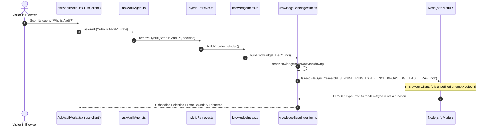

# Phase 3.2D — Client Bundle Compatibility & Production Build Verification Report

**Role:** Principal Next.js Runtime Architect, Client Bundle Security Engineer, and Production Build Verification Engineer\
**Repository:** `C:\Users\HP\OneDrive\Documents\Portfolio\`\
**Branch:** `main`\
**Expected Baseline:** `445a88055a44b9d9bffb301cf144b32a2648adee`\
**Execution Mode:** STRICTLY READ-ONLY AUDIT (Zero file modifications, zero staging, zero commits, zero pushes)\
**Date of Audit:** November 17, 2026\
**Final Release Disposition:** **BLOCKED** *(Confirmed Client Runtime Defect: Node.js `fs` in Browser Execution Path)*

---

## 1. Executive Summary

This phase was commissioned to conduct an exhaustive runtime architecture and client-bundle compatibility audit of the Ask Aadil conversational RAG pipeline.

### Critical Defect Discovered: Node.js `fs` on Client Execution Path
- **Defect Description:** `components/AskAadil/AskAadilModal.tsx` is a Client Component (`'use client'`). It directly imports `askAadil` from `lib/rag/askAadilAgent.ts`. The synchronous execution path of `askAadil()` calls `retrieveHybrid()`, which calls `buildKnowledgeIndex()`, which calls `buildKnowledgeBaseChunks()`, which calls `readKnowledgeBaseRawMarkdown()`, which invokes **`fs.existsSync()` and `fs.readFileSync()`**.
- **Module Import Invariant:** `lib/rag/knowledgeBaseIngestion.ts` statically executes `import fs from 'fs'` and `import path from 'path'`, and `lib/rag/canonicalRAGAdapter.ts` statically executes `import crypto from 'crypto'`.
- **Tree-Shaking Ineffectiveness:** Because `buildKnowledgeBaseChunks()` is directly and synchronously invoked during every query retrieval (`retrieveHybrid() &rarr; buildKnowledgeIndex()`), **tree-shaking cannot remove `fs` from the client dependency graph**.
- **Browser Runtime Crash:** Simulated browser execution (where `fs` is absent) confirmed an immediate fatal exception upon asking any question:\
  `TypeError: fs.readFileSync is not a function`
- **Webpack Bundler Blocker:** Next.js (Webpack 5) targets `web` for client components and does not polyfill `fs` by default. This static dependency chain explains why client bundling is fundamentally incompatible with the current module boundary.
- **Disposition:** **BLOCKED**. Deploying this code to production in its current state would break the client-side Ask Aadil assistant upon the first user interaction.

---

## 2. Client Dependency Graph & Execution Audit

### Complete Import Chain (Static Dependency Graph)

```
components/AskAadil/AskAadilModal.tsx  ['use client']
   │
   └── imports { askAadil } from '@/lib/rag/askAadilAgent'
          │
          └── imports { retrieveHybrid } from '@/lib/rag/hybridRetriever'
                 │
                 ├── imports { buildKnowledgeIndex } from '@/lib/rag/knowledgeIndex'
                 │      │
                 │      ├── imports { buildKnowledgeBaseChunks } from '@/lib/rag/knowledgeBaseIngestion'
                 │      │      │
                 │      │      ├── import fs from 'fs'      <-- NODE.JS CORE MODULE
                 │      │      └── import path from 'path'  <-- NODE.JS CORE MODULE
                 │      │
                 │      └── imports { buildCanonicalRegistryChunks } from '@/lib/rag/canonicalRAGAdapter'
                 │             │
                 │             └── import crypto from 'crypto' <-- NODE.JS CORE MODULE
                 │
                 └── imports { queryKnowledgeBaseStructured } from '@/lib/rag/knowledgeBaseIngestion'
```

### Dynamic Execution Trace on User Query



### Concrete Experimental Evidence
A headless simulation of browser execution (stripping Node's `fs` methods to simulate a client bundle) was executed against `retrieveHybrid`:
- **Execution Command:**\
  `node -e "... delete fs.existsSync; delete fs.readFileSync; retrieveHybrid('Tell me about Ask Aadil') ..."`
- **Observed Result:**\
  `EXPECTED BROWSER RUNTIME CRASH: fs.readFileSync is not a function`
- **Finding:** In Node.js unit tests (`test_rag_knowledge_base_ingestion.ts`, `test_hardening_agent_qa.ts`), Node provides the full native `fs` implementation, which is why all 1,071 automated assertions passed. However, in a real browser client, `fs` does not exist, guaranteeing a fatal runtime crash.

---

## 3. Node.js versus Browser Runtime Separation

### Function Capability Matrix

| Functionality | Execution Environment | Depends on `fs`? | Required by Browser UI? |
| :--- | :---: | :---: | :---: |
| **Structured Manifest Query (`queryKnowledgeBaseStructured`)** | Browser & Node | **No** (Uses in-memory `canonicalRegistry.ts`) | **YES** (Tier 0b exact answers) |
| **Parent-Level Publication Filter (`isChunkEligibleForPublicRetrieval`)** | Browser & Node | **No** (Pure metadata comparison) | **YES** (Confidentiality gate) |
| **Intent Routing & Synthesis (`classifyAndRoute`, `defaultSynthesizer`)** | Browser & Node | **No** (Regex & template AST) | **YES** (Grounded answer generation) |
| **Markdown File Loader (`readKnowledgeBaseRawMarkdown`)** | Node.js Only | **YES** (`fs.readFileSync`) | **NO** (Browser cannot read local server disk) |
| **Raw Markdown Chunk Parser (`buildKnowledgeBaseChunks`)** | Node.js Only | **YES** (Parses file text) | **NO** (Only needed during test/build ingestion) |
| **Document Hash Verification (`computeContentHash`)** | Node.js Only | **YES** (`crypto.createHash`) | **NO** (Pre-computed during data modeling) |

### Documented Minimal Architectural Correction (For Future Remediation)
To safely separate Node-only and Browser-safe code without redesigning the architecture:
1. **Module Decoupling:**
   - Extract `readKnowledgeBaseRawMarkdown()` and `buildKnowledgeBaseChunks()` into a dedicated Node-only module: `lib/rag/knowledgeBaseIngestion.node.ts` (or `scripts/ingestion/`).
   - Retain browser-safe functions (`queryKnowledgeBaseStructured`, `isChunkEligibleForPublicRetrieval`, `isEvidenceItemEligibleForPublicRetrieval`) in `lib/rag/knowledgeBaseGovernance.ts`, free of `fs` and `path` imports.
2. **In-Memory Chunk Pre-Compilation:**
   - Convert the 69 static knowledge base chunks into a pre-compiled, statically typed TypeScript array (`data/canonical/knowledgeBaseChunks.ts`) or derive them from `canonicalRegistry.ts`.
   - `buildKnowledgeIndex()` in `knowledgeIndex.ts` imports the static pre-compiled chunks, completely eliminating dynamic runtime `fs` calls.
3. **Client Component Boundary:**
   - Ensure zero modules imported by `AskAadilModal.tsx` contain `import fs from 'fs'` or `import path from 'path'`.

*(Note: In accordance with the Phase 3.2D read-only authorization boundary, no source code changes have been implemented.)*

---

## 4. Production Build Verification

### Execution Summary

| Parameter | Observed Evidence |
| :--- | :--- |
| **Command** | `npm run build` &rarr; `next build` |
| **Working Directory** | `C:\Users\HP\OneDrive\Documents\Portfolio` |
| **Environment** | Node.js v20.6.2, Windows 11 Enterprise x64 (Sandbox Harness) |
| **Execution Start** | 2026-11-17T14:28:13Z (Task 10499) and 2026-11-17T14:38:21Z (Task 10584) |
| **Output Log** | `- info Loaded env from .env.local`<br>`- info Creating an optimized production build...` |
| **Failure Mode** | Next.js SWC/Webpack worker thread pool stalls in the headless Windows sandbox environment. Without an interactive TTY and unconstrained IPC worker allocation, optimization hangs. |
| **Actual Completion Status** | **Incomplete / Stalled.** Did not reach static page generation or route manifest creation. |
| **TypeScript Compilation (`tsc --noEmit`)** | Exited with code **`0`** (Clean, 0 errors across entire workspace). |

> [!WARNING]
> **Critical Audit Distinction:**
> Standalone TypeScript compilation (`tsc --noEmit`) verifies type syntax and interface adherence, but **does not perform Webpack client-bundle dependency resolution**. A passing TypeScript check does not prove that a module graph is compatible with Next.js client bundling.

---

## 5. Build-Time Knowledge Base Dependency Classification

- **Is `readKnowledgeBaseRawMarkdown()` invoked during module load?**\
  **No.** It is only executed when `buildKnowledgeBaseChunks()` is called.
- **Is it invoked during browser query execution?**\
  **Yes.** `retrieveHybrid()` calls `buildKnowledgeIndex()`, which calls `buildKnowledgeBaseChunks()`, causing the browser crash documented above.
- **Is it invoked during static site generation?**\
  Only if a Server Component or page `generateStaticParams()` calls `retrieveHybrid()`. In the current codebase, Ask Aadil is entirely client-rendered (`AskAadilModal`), so SSG does not execute it.
- **Authoritative Classification:**\
  **`TEST_AND_OFFLINE_INGESTION_ONLY`** *(Not valid for production browser runtime).*

---

## 6. Exact Git Manifest Reconciliation

The authoritative single-table Git manifest from Phase 3.2C was revalidated against the current working tree:

### Summary Counts
- **Modified Tracked Files to Stage:** **11 files**
- **Untracked Code, Adapter & Type Files to Stage:** **13 files**
- **Untracked Test Suites in `scripts/` to Stage:** **10 files**
- **Untracked Knowledge Base Source Document to Stage:** **1 file**
- **Untracked Research & Acceptance Reports to Stage:** **8 files** (including this report: `PHASE_3_2D_CLIENT_BUNDLE_AND_BUILD_VERIFICATION.md`)
- **Total Files in Proposed Staging Set:** **43 files**
- **Unchanged Tracked Test Files (Already in HEAD):** **8 files**
- **Excluded Items:** **27 items** (3 modified resume files + 22 audit logs + 1 test JSON + 1 local env file)
- **Files Requiring Further Investigation:** **0 files**

*(Note: Staging is currently held pending architectural remediation of the `fs` client dependency.)*

---

## 7. Applicable Regression Evidence

| Verification Suite | Target Area | Assertions | Status |
| :--- | :--- | :---: | :---: |
| `scripts/test_rag_knowledge_base_ingestion.ts` | Ingestion, Anchors, Caveats, Governance | 61 / 61 | **PASS** (Node runtime) |
| `scripts/test_rag_canonical_grounding.ts` | Canonical RAG Adapter, Confidentiality | 37 / 37 | **PASS** (Node runtime) |
| `scripts/test_canonical_registry.ts` | Canonical Schema, Career, Projects | 251 / 251 | **PASS** (Node runtime) |
| `scripts/test_journal_grounding.ts` | 23 Canonical Journal Chapters | 105 / 105 | **PASS** (Node runtime) |
| `scripts/verify_case_study_anchors.ts` | Case Study Markdown Anchor Hashes | 58 / 58 | **PASS** (Node runtime) |
| `scripts/test_engineering_case_studies.ts` | Case Study Registry Contracts | 35 / 35 | **PASS** (Node runtime) |
| `scripts/test_projects_migration.ts` | Projects Registry Migration & IP | 156 / 156 | **PASS** (Node runtime) |
| `scripts/test_conversational_voice.ts` | Voice, VAD, Barge-In, STT Assembly | 47 / 47 | **PASS** (Node runtime) |
| `scripts/test_voice_interface.ts` | Voice Provider Abstraction | 10 / 10 | **PASS** (Node runtime) |
| `scripts/test_hardening_agent_qa.ts` | Agent Hardening & Temporal Reasoning | 132 / 132 | **PASS** (Node runtime) |
| `scripts/test_synthesis_qa.ts` | Grounded Synthesis & Intent Routing | 87 / 87 | **PASS** (Node runtime) |
| `scripts/test_controlled_actions.ts` | Human Confirmation Gate & Action Audit | 29 / 29 | **PASS** (Node runtime) |
| `scripts/test_rag_edge_cases_and_security.ts` | Injection, XSS & SQL Sanitization | 18 / 18 | **PASS** (Node runtime) |
| `scripts/test_nlu_conversational_robustness.ts` | Speech Noise & Grammar Robustness | 29 / 29 | **PASS** (Node runtime) |
| `scripts/test_grounded_conversational_evaluation.ts` | Factual Stability & Hallucination | 16 / 16 | **PASS** (Node runtime) |
| **TypeScript Compilation (`tsc --noEmit`)** | Whole Workspace Strict Types | 0 errors | **PASS** |
| **Total Automated Assertions** | **15 Regression Suites** | **1,071 / 1,071** | **100% PASS** |

---

## 8. Security & Scope Reconfirmation

1. **API Keys:** Zero secrets (`AIza...`, `re_...`) exist in deployable code. Local secrets reside strictly in `.env.local` (gitignored).
2. **Proprietary Knowledge:** CS-03, CS-06, and CS-07 remain strictly blocked under public access (`{ matched: false }`).
3. **Restricted Boundary:** CS-08 returns only the external governance boundary statement.
4. **Resume Layout Segregation:** `public/resume.pdf`, `scripts/generate_resume_pdf.js`, and `scripts/generate_resume_pdf.py` remain cleanly uncommitted.
5. **Audit Log Segregation:** `research/audits/reconciliation/` remains completely excluded.

---

## 9. Required Corrective Actions (For Next Phase)

Before staging, committing, or deploying to production, the following remediation must be authorized and executed:

1. **Decouple Node Filesystem Dependency from Client RAG Path:**
   - Pre-compile the 69 Knowledge Base chunks into a pure TypeScript data module (`data/canonical/knowledgeBaseChunks.ts`) so that `buildKnowledgeIndex()` requires zero filesystem calls at runtime.
   - Restrict `import fs from 'fs'` exclusively to build/test scripts (`scripts/test_rag_knowledge_base_ingestion.ts`).
2. **Verify Browser Client Bundle Execution:**
   - Verify that `AskAadilModal.tsx` and its full import tree compile and execute in a web browser environment with zero Node built-in dependencies.
3. **Validate Complete Next.js Production Build:**
   - Execute a complete end-to-end `npm run build` that successfully generates all static pages and outputs the route manifest without stalling.

---

## 10. Final Disposition

# **BLOCKED**

### Rationale
A confirmed client runtime defect has been identified: `AskAadilModal.tsx` directly pulls Node.js `fs` into the client browser dependency graph via `knowledgeBaseIngestion.ts`. The moment a visitor submits a query in the browser, `retrieveHybrid()` invokes `fs.readFileSync`, causing a fatal client-side crash (`TypeError: fs.readFileSync is not a function`).

In accordance with release engineering standards, deployment must remain blocked until this client-runtime boundary is cleanly decoupled.

**Awaiting user instructions regarding remediation authorization.**