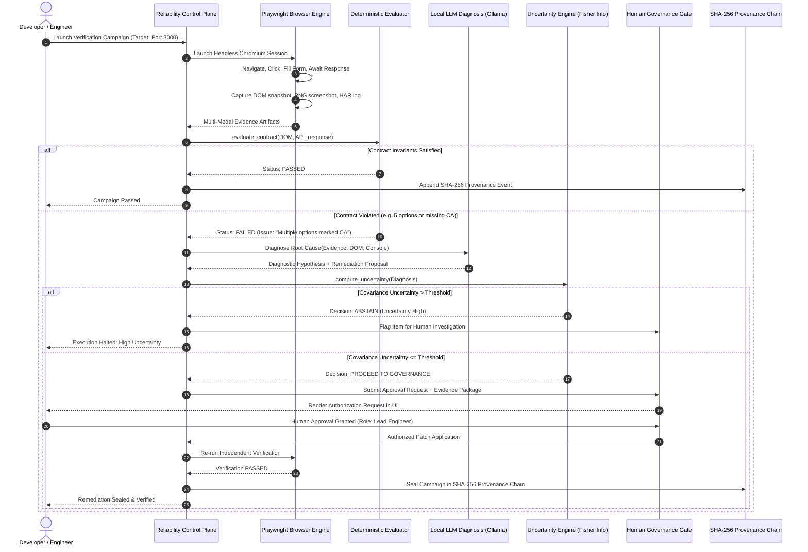

# Runtime Flow & Execution Lifecycle — AI Application Reliability

## 1. End-to-End Verification & Remediation Lifecycle

## 2. Mathematical Fisher Information Uncertainty Formulation
The uncertainty engine models parameter confidence using the empirical Fisher Information Matrix $\mathcal{I}(\theta)$:
$$\mathcal{I}(\theta) = \mathbb{E}\left[ \nabla_\theta \log p(x \mid \theta) \nabla_\theta \log p(x \mid \theta)^T \right]$$
The covariance of the parameter estimates satisfies the Cramér-Rao lower bound:
$$\operatorname{Cov}(\hat{\theta}) \ge \mathcal{I}(\theta)^{-1}$$
When the trace or maximum eigenvalue of the estimated covariance matrix exceeds the configured threshold $\epsilon_{\text{abstain}}$, the diagnostic engine treats the model output as ungrounded and strictly abstains from recommending automated patches.
