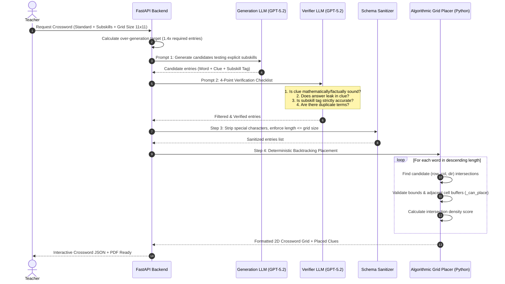

# Runtime Flow & Execution Lifecycle — AI Worksheets

## 1. Formal Worksheet & TikZ Rendering Sequence

```mermaid
sequenceDiagram
    autonumber
    actor Teacher as Teacher / Educator
    participant UI as React Client (Vite 6)
    participant API as FastAPI Backend
    participant LLM as Portkey / GPT-4o
    participant TikZ_AI as Gemini 2.0/3 Flash
    participant Subprocess as pdflatex + pdftoppm
    participant S3 as MinIO / Cloudflare R2
    participant Weasy as WeasyPrint Engine

    Teacher->>UI: Select TEKS Standard + Question Types + Count
    UI->>API: POST /api/v1/worksheets/formal/generate
    API->>LLM: Generate questions with optional diagram descriptions
    LLM-->>API: JSON: [ { question, options, diagram_description } ]

    rect rgb(240, 255, 240)
        note over API,Subprocess: TikZ Compilation Pipeline
        loop For each question with diagram_description
            API->>API: Compute MD5 hash of description
            alt Hash in static cache
                API->>API: Return cached PNG URL
            else Cache miss
                API->>TikZ_AI: Prompt: Output ONLY compilable LaTeX standalone
                TikZ_AI-->>API: LaTeX code (\documentclass ... \end{document})
                API->>API: Sanitize LaTeX fences (_clean_latex_output)
                API->>Subprocess: Write to tempdir/image.tex; exec pdflatex
                Subprocess-->>API: image.pdf
                API->>Subprocess: exec pdftoppm -png -r 300 image.pdf
                Subprocess-->>API: image.png (300 DPI)
                API->>API: Save to static/tikz-images/<hash>.png
            end
        end
    end

    API-->>UI: Return complete worksheet JSON with rendered diagram URLs
    Teacher->>UI: Review & Click "Export PDF"
    UI->>API: POST /api/v1/worksheets/formal/export-pdf
    API->>Weasy: Render Jinja2 template with embedded high-res PNGs
    Weasy-->>API: Binary PDF
    API-->>UI: Stream Downloadable PDF
```

## 2. Gamified Crossword Three-Prompt Pipeline


