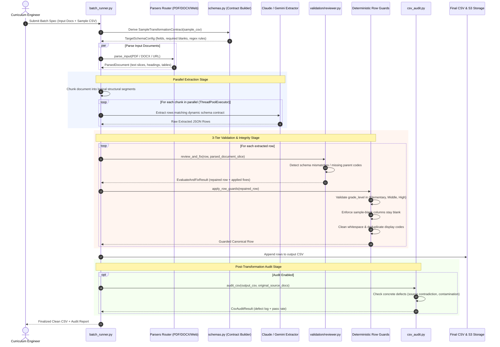

# Runtime Flow & Execution Lifecycle — Curriculum Transformation Engine

## 1. End-to-End Extraction Sequence

## 2. Dynamic Schema Derivation Workflow
1. **Sample Ingestion**: The system reads `default_sample_schema.csv` (or a custom approved sample CSV).
2. **Contract Synthesis**: `load_schema_config()` extracts:
   - Header column order
   - Hierarchy definitions (e.g. `l1` Domain, `l2` Cluster, `l3` Standard, `l4` Sub-indicator)
   - Forced blank columns (`DRAFT_ALWAYS_BLANK_COLUMNS`)
   - Grade level mapping dictionaries (`GRADE_LEVEL_NAMING_RULE`).
3. **Dynamic Pydantic Generation**: Schema structures are compiled into dynamic Pydantic models at runtime via `create_model()`, enforcing field types without hardcoding a Python class for each new state format.
