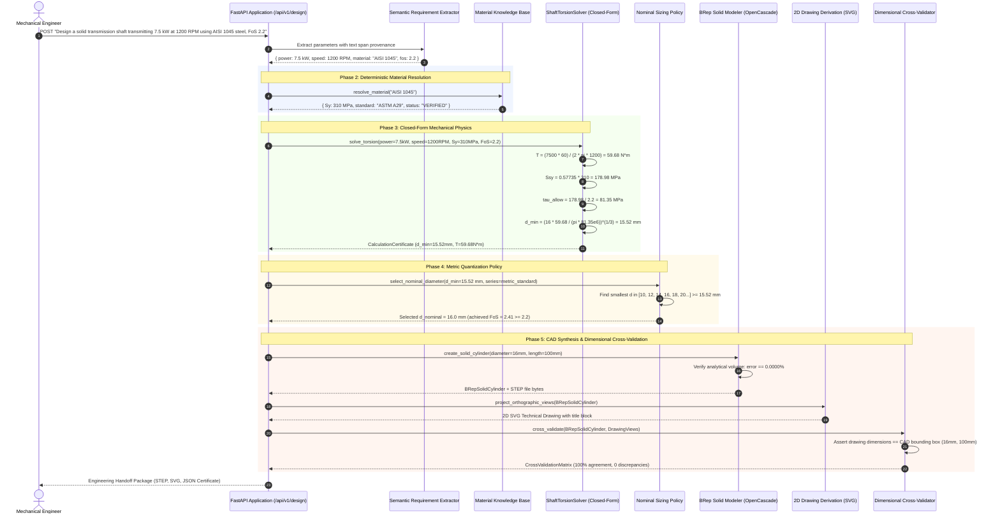

# Runtime Flow & Execution Lifecycle — Engineering Design Automation

## 1. Execution Sequence Diagram

## 2. Derivation Equations & Invariants
1. **Torque Invariant**:
   $$T = \frac{P}{\omega} = \frac{60 \cdot P}{2 \pi N}$$
2. **von Mises Shear Yield Invariant**:
   $$S_{sy} = \frac{S_y}{\sqrt{3}} \approx 0.577350269 \cdot S_y$$
3. **Allowable Shear Stress**:
   $$\tau_{\text{allow}} = \frac{S_{sy}}{\text{FoS}}$$
4. **Minimum Theoretical Diameter**:
   $$d_{\text{min}} = \sqrt[3]{\frac{16 T}{\pi \tau_{\text{allow}}}}$$
5. **Nominal Quantization Invariant**:
   $$d_{\text{nominal}} = \min \{ d \in \text{StandardSeries} \mid d \ge d_{\text{min}} \}$$
