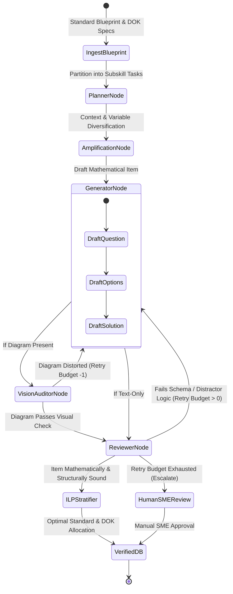

# Runtime Flow & Execution Lifecycle — US Mathematics Item Bank

## 1. Hypothesized Execution Flow

Based on the architectural specifications documented in the portfolio chapters, the claimed system executes according to the following state graph:

## 2. Theoretical Invariants & Node Contracts
1. **Planner $\rightarrow$ Generator Contract**: Must pass exact subskill ID, target cognitive level (DOK 1, 2, or 3), and numerical constraint envelope.
2. **Cyclic Retry Invariant**: Node retries are bounded by an integer budget (claimed: 3). If a node fails verification 3 times consecutively, the state transitions to an `escalate_to_human` dead-letter queue.
3. **ILP Objective Function**: Minimizes the deviation between observed item counts and target curriculum distribution across standards and difficulty tiers:
   $$\min \sum_{s \in \text{Standards}} |N_s - T_s| + \sum_{d \in \text{DOK}} |N_d - T_d|$$
   Subject to integer item selection constraints.
