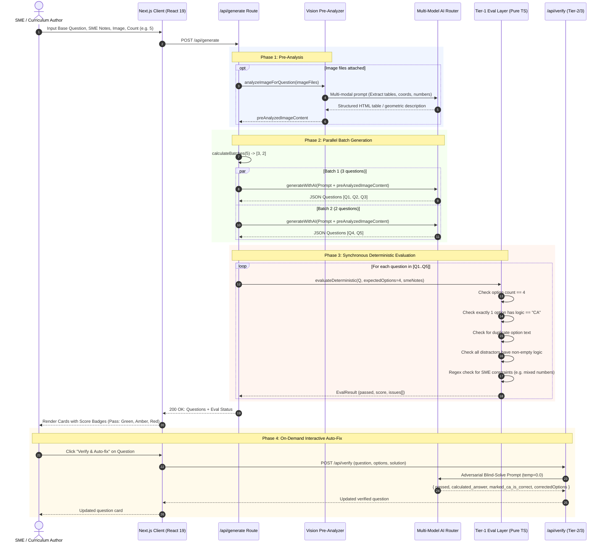

# Runtime Flow & Execution Lifecycle — VM Copy Question Generator

## 1. End-to-End Sequence Diagram



## 2. Execution Stages & Data Transformations

### Stage 1: Batch Calculation
- **Input**: Integer count (e.g., 5).
- **Transformation**: `calculateBatches(numQuestions)` partitions request into array `[3, 2]`.
- **Purpose**: Prevents single-prompt timeout and token context bloat. Ensures fast parallel generation across worker slots.

### Stage 2: Prompt Interpolation & Generation
- **Input**: Base question string, grade, curriculum, SME notes, parsed options count.
- **Output**: Raw string from model containing JSON payload:
  ```json
  [
    {
      "question": "...",
      "options": [
        { "text": "...", "logic": "CA" },
        { "text": "...", "logic": "Common misconception: added denominators instead of finding LCD" }
      ],
      "solution": "Step 1: ...\nStep 2: ..."
    }
  ]
  ```

### Stage 3: Deterministic Scoring Mechanics
- **Initial Score**: 100 points.
- **Deductions**:
  - Missing question text or length < 5 characters: `-30`
  - Option count $\ne$ expected: `-25`
  - Zero options marked `CA`: `-35`
  - Multiple options marked `CA`: `-30`
  - Empty option text: `-15` per instance
  - Duplicate option text: `-20`
  - Missing distractor logic: `-5` per instance
  - Solution missing "Step 1" format: `-10`
  - Missing solution entirely: `-15`
  - SME mixed-number regex mismatch: `-20`
- **Output Score**: `Math.max(0, score)`. Passed flag requires `issues.length === 0`.
